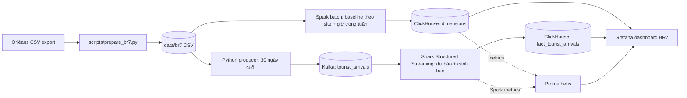
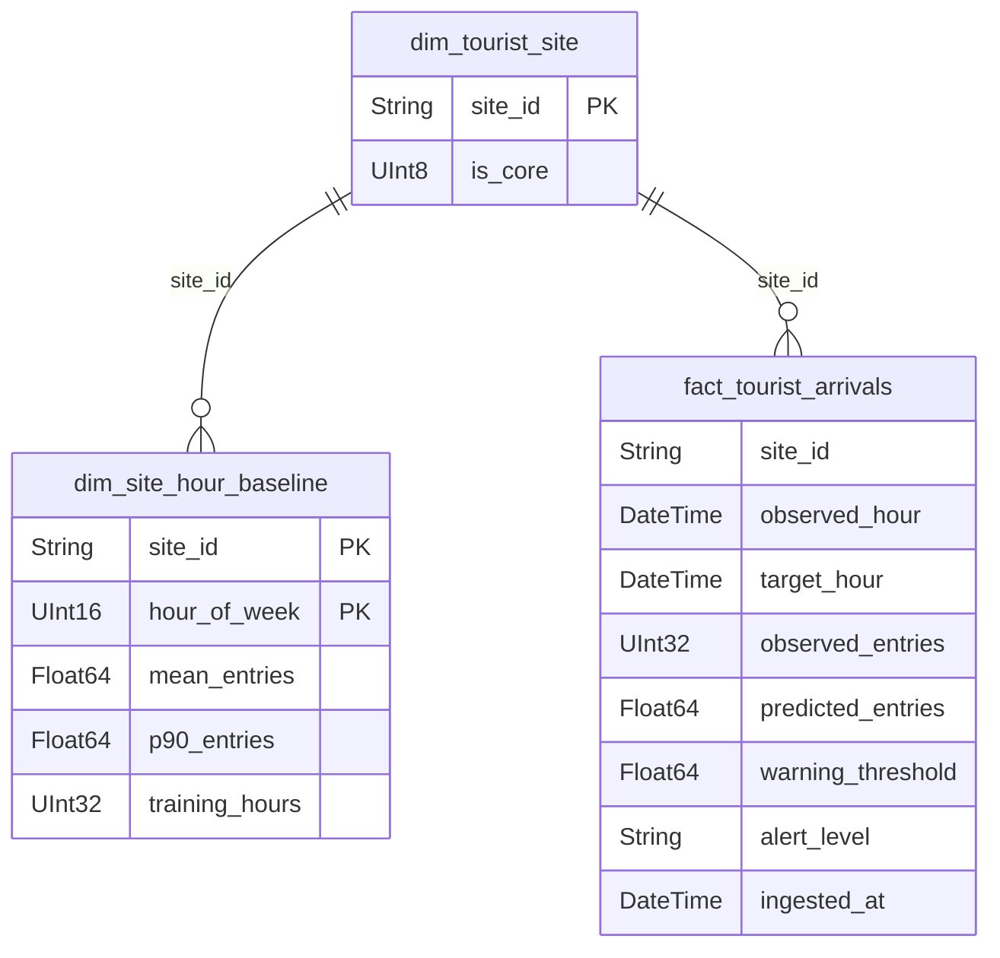

# Runbook BR7 — Cảnh báo lượng khách đến địa điểm du lịch tăng bất thường

## 1. Business requirement và phạm vi

Với mỗi địa điểm du lịch được theo dõi, sau khi nhận số **lượt vào trong giờ vừa kết thúc**, ước tính số lượt vào **giờ tiếp theo** và gắn cờ `warning` nếu dự báo vượt ngưỡng cao thường thấy của chính địa điểm đó vào cùng thứ và giờ. Ban quản lý xem bảng các cảnh báo trong Grafana để chuẩn bị nhân sự hoặc điều phối khách.

Đây là cảnh báo **lượng khách đến bất thường**, không phải số người đang có mặt hay chứng nhận vượt sức chứa. Dữ liệu nguồn không có thời gian lưu lại, lượt ra, sức chứa hoặc ngưỡng an toàn pháp lý. Một bản ghi nguồn là số lượt vào của **một địa điểm trong một giờ**, không phải một khách hàng hay một sự kiện check-in.

## 2. Nguồn dữ liệu và lựa chọn địa điểm

- Nguồn: [Orléans Métropole — Fréquentation des sites touristiques par heure](https://data.orleans-metropole.fr/explore/dataset/frequentation-par-heure/), [CSV export API](https://data.orleans-metropole.fr/api/explore/v2.1/catalog/datasets/frequentation-par-heure/exports/csv?delimiter=%2C).
- Cột dùng: `site` (tên địa điểm), `horodatage` (giờ quan sát có múi giờ), `entrees` (lượt vào trong giờ). Không có khóa khách du lịch và không có dữ liệu sức chứa.
- Nguồn có 8 tên địa điểm; pipeline theo dõi 6 địa điểm có lịch sử thường xuyên. Hai địa điểm có dữ liệu thưa được giữ trong `dim_tourist_site` với `is_core = 0`, nhưng không phát lại hoặc tính cảnh báo. Tên và phạm vi được khóa trong [br7_sites.py](jobs/common/br7_sites.py).
- Dữ liệu tải về `data/br7/frequentation_par_heure.csv` ở lần chạy đầu. File này được `.gitignore` vì là snapshot công khai có thể tải lại. `--refresh` tải snapshot mới. Số hàng và ngày mới nhất của nguồn có thể thay đổi; kiểm tra tại thời điểm chạy.
- Bản demo dùng 30 ngày cuối trong snapshot để phát lại qua Kafka theo thứ tự giờ quan sát. Các giờ cũ hơn dùng để tính baseline. Cách chia theo thời gian này tránh dùng chính dữ liệu đang phát lại để xây ngưỡng. Snapshot kiểm tra ngày 05/10/2026 có 153.373 dòng CSV, trong đó 153.372 dòng hợp lệ; 1.094 dòng thuộc 6 site core trong 30 ngày cuối. 1.050/1.094 dòng đó có baseline đủ 10 quan sát cho giờ đích.

## 3. Kiến trúc và luồng dữ liệu



Các container và cấu hình mạng, volumes, health checks, metrics, provisioning Grafana dùng nguyên mẫu trong `docker-compose.yml`. `scripts/start.py` tự phát hiện BR từ `ddl_br*.sql`, chuẩn bị dữ liệu nếu có `prepare_br*.py`, tạo Kafka topic, chạy DDL, khởi động Spark job rồi mới chạy producer. `make demo` chạy tất cả BR hiện diện trong checkout. Theo yêu cầu xóa BR3/BR4 trên nhánh này, sau khi PR merge thì lệnh đó chỉ chạy BR7, trừ khi các BR khác được thêm lại.

## 4. Quy tắc xử lý

1. Loại dòng thiếu `site`, `horodatage`, `entrees`, thời gian không parse được hoặc lượt vào âm; chỉ giữ 6 site core.
2. Tính `hour_of_week = weekday * 24 + hour` theo UTC, với thứ Hai = 0. Mỗi site có tối đa 168 ô giờ trong tuần.
3. Trên dữ liệu trước cửa sổ phát lại 30 ngày, tính `mean_entries`, phân vị 90 `p90_entries`, và `training_hours` cho từng `(site_id, hour_of_week)`. Chỉ dùng ô có ít nhất 10 bản ghi lịch sử.
4. Với một quan sát tại giờ `t`, `target_hour = t + 1 giờ`. Dự báo heuristic: `predicted_entries = (observed_entries(t) + mean_entries(site, target_hour)) / 2`.
5. `warning_threshold = p90_entries(site, target_hour)`. Đặt `alert_level = warning` khi `predicted_entries > warning_threshold`, còn lại là `normal`.

Đây là quy tắc dự báo dễ giải thích để demo pipeline, không phải mô hình đã được hiệu chỉnh hoặc kiểm định độ chính xác. Nếu một ô thiếu ít nhất 10 giờ huấn luyện, phép join không tạo bản ghi fact cho ô đó. Cần kiểm tra độ phủ trước khi dùng cho vận hành.

## 5. Mô hình dữ liệu ClickHouse



| Bảng | Grain | Vai trò |
| --- | --- | --- |
| `dim_tourist_site` | Một hàng/site | Danh mục 8 site và cờ `is_core` cho 6 site được theo dõi. |
| `dim_site_hour_baseline` | Một hàng/site/giờ trong tuần | Thống kê lịch sử để tính dự báo và ngưỡng cảnh báo. |
| `fact_tourist_arrivals` | Một hàng/site/giờ quan sát được xử lý | Lượt vào đã thấy, dự báo giờ kế tiếp, ngưỡng và trạng thái. |

Schema nằm ở [ddl_br7.sql](sql/clickhouse/ddl_br7.sql). Lần chạy demo kế tiếp xóa dữ liệu fact BR7 trước khi phát lại. Spark tính lại và thay thế hai dimension BR7. Kafka topic được reset bởi `scripts/topics.py --reset`. Đây là luồng demo có phát lại lịch sử, chưa phải hệ thống cảnh báo thời gian thực từ cảm biến trực tiếp.

## 6. Runbook chạy demo

**Yêu cầu:** Docker Engine + Docker Compose, Python 3 trên máy host, kết nối Internet lần đầu để tải CSV và tải image/gói Spark. Dành đủ bộ nhớ cho các dịch vụ trong `docker-compose.yml`. Chạy lệnh từ thư mục gốc repository.

```bash
# Chỉ chạy BR7 trên nhánh này
make demo-br BR=7

# Giới hạn 500 thông điệp để thử nhanh
make demo-br BR=7 PRODUCER_LIMIT=500

# Sau khi merge với main: một lệnh cho tất cả BR có trong checkout
make demo
```

Lệnh chạy sẽ chờ Spark streaming sẵn sàng rồi phát các quan sát. Giữ terminal mở để Spark tiếp tục xử lý; `Ctrl+C` dừng job và producer. `make down` dừng các container. `make logs` xem log job; file cụ thể là `logs/demo/br7-spark.log` và `logs/demo/br7-producer.log`. `make ps` xem trạng thái container.

**Làm mới nguồn:**

```bash
python3 scripts/prepare_br7.py --refresh
make demo-br BR=7
```

**Kiểm tra dữ liệu:**

```bash
docker exec clickhouse clickhouse-client --user default --password clickhouse --query "SELECT count() FROM dim_tourist_site"
docker exec clickhouse clickhouse-client --user default --password clickhouse --query "SELECT count(), min(observed_hour), max(target_hour), countIf(alert_level = 'warning') FROM fact_tourist_arrivals"
docker exec clickhouse clickhouse-client --user default --password clickhouse --query "SELECT site_id, count(), countIf(alert_level = 'warning') FROM fact_tourist_arrivals GROUP BY site_id ORDER BY site_id"
```

Mở Grafana tại `http://localhost:3000` (mặc định `admin` / `admin`), thư mục `CO5173`, dashboard **BR7 Tourist arrival warnings**. Bảng “Latest forecast by site” cho biết dự báo mới nhất và `alert_level` theo site; “Recent warning hours” liệt kê các giờ bị gắn cờ. Spark Master: `http://localhost:8082`; Prometheus: `http://localhost:9090`; ClickHouse HTTP: `http://localhost:8123`.

## 7. Giới hạn và cách đọc cảnh báo

- Cảnh báo chỉ nói lượng **vào** dự báo cao hơn lịch sử tương ứng. Không suy ra số khách đang có mặt, quá tải theo sức chứa, hoặc nguy cơ an toàn đã xác thực.
- CSV công khai có thể cập nhật trễ; nhìn `max(target_hour)` trong fact để biết cảnh báo mới đến thời điểm nào. Replay 30 ngày là dữ liệu lịch sử, không phải cảnh báo cho giờ hiện tại ngoài đời thực.
- Nguồn không cam kết đủ mọi site và mọi giờ. Hai site partial được loại khỏi xử lý. Các ô giờ thiếu baseline đủ dài cũng bị bỏ qua.
- `fact_tourist_arrivals` dùng MergeTree như template; nếu tự chạy producer lặp hoặc gửi lại event mà không reset thì có thể có hàng trùng. Luồng `make demo-br` reset topic/fact trước khi chạy.
- Dashboard thể hiện cảnh báo trong bảng; chưa cấu hình thông báo email, SMS hoặc Grafana Alerting.
