# BR8 — Tỷ lệ user quay lại điểm tham quan từ lần thứ hai

## Phạm vi và chỉ số

BR8 dùng TripWorld để tính tỷ lệ user có **ít nhất hai ngày ghé khác nhau tại cùng một địa điểm**:

```text
repeat_visit_rate(place) = returning_visitors / unique_visitors × 100%
returning_visitors = số user có visit_count ≥ 2 ở chính place đó
```

Một lượt ghé được quy ước là `(user_id, place_id, ngày UTC)`. Các check-in trong cùng ngày được gom thành một lượt và giữ thời gian sớm nhất. Đây là quy ước đo trên dữ liệu check-in, không phải số chuyến thực tế được xác nhận. Quay lại một bảo tàng khác không tính là quay lại bảo tàng đầu tiên.

Chỉ dùng check-in ở nơi đến du lịch (`c_o`) và yêu cầu `r_h != r_o`. Không dùng check-in ở quê nhà (`c_h`). Chỉ giữ địa điểm có tên và category/schema phù hợp nhóm tham quan; danh sách từ khóa nằm trong `jobs/common/br8_rules.py`.

Chỉ số là **tỷ lệ ghé lại trong toàn bộ khoảng quan sát**, không phải D30/D90 cohort retention. User xuất hiện cuối kỳ có ít cơ hội quay lại hơn. Khi tổng hợp nhiều địa điểm, mẫu số là **cặp user–địa điểm**, không phải số user duy nhất trên toàn hệ thống.

## Dataset

- Nguồn: [TripWorld của CRUISE Research Group](https://huggingface.co/datasets/CRUISEResearchGroup/TripWorld).
- [Schema và provenance](https://huggingface.co/datasets/CRUISEResearchGroup/TripWorld/blob/main/README.md).
- Pipeline khóa snapshot `421bc1d`, kiểm tra SHA-256 theo `MANIFEST.json` trước khi đọc Parquet.
- Chỉ tải `travel_behaviors.parquet`, `metadata/metadata_all.parquet` và `region_labels.parquet` (khoảng 307 MB). Không tải bộ Google reviews.
- Tên địa điểm lấy từ `fsq_name`, dự phòng bằng `google_name`. Join chính xác `ci.venue_id = metadata.fsq_place_id`; không tự suy đoán tên từ tọa độ.
- License của release: CC BY-NC 4.0; trích dẫn dataset khi dùng trong báo cáo.

Mặc định chọn vùng đô thị Tokyo (`Q1490`, theo mapping TripWorld, có thể gồm Yokohama/Urayasu) và 20 điểm tham quan có nhiều user nhất. Giữ toàn bộ lịch sử của các điểm được chọn; không lấy ngẫu nhiên từng dòng và không chọn theo tỷ lệ quay lại. Đổi bằng `BR8_REGION` và `BR8_MAX_PLACES`.

## Luồng xử lý

```mermaid
flowchart LR
  SOURCE[TripWorld: 3 Parquet files] --> PREP[Spark batch: c_o + metadata + region]
  PREP --> CSV[Named places + daily visits CSV]
  CSV --> PROD[Python historical replay]
  PROD --> KAFKA[Kafka: br8_tourist_visits]
  KAFKA --> SPARK[Spark Structured Streaming]
  SPARK --> FACT[ClickHouse: daily visits]
  FACT --> VIEWS[User retention + place retention + history]
  VIEWS --> GRAFANA[Grafana BR8 dashboard]
```



Chuẩn hóa: bung `c_o`, loại thiếu ID/thời gian/user không hợp lệ, loại check-in trùng `(user, place, timestamp)`, join tên/category, lọc điểm tham quan, rồi gom theo ngày UTC. `trail_id` không được dùng để đếm số chuyến vì nó chỉ là session và có thể lặp giữa nhiều bản ghi nguồn.

Producer gửi CSV theo thứ tự lịch sử, mỗi message là một lượt ghé/ngày đã chuẩn hóa. Spark xác thực ID deterministic và ngày UTC, kiểm tra địa điểm có trong dimension, rồi ghi theo từng partition vào ClickHouse. Đây là **phát lại dữ liệu lịch sử**, không phải nguồn check-in trực tiếp đang hoạt động.

## Output

| Bảng/view | Grain | Vai trò |
| --- | --- | --- |
| `dim_br8_places` | Một địa điểm | ID, tên, loại, thành phố, quốc gia, tọa độ. |
| `fact_br8_visits` | Một user–địa điểm–ngày UTC | Lượt ghé và số check-in nguồn đã gom. |
| `v_br8_user_retention` | Một user–địa điểm | Số ngày ghé, lần đầu/cuối, cờ đã quay lại. |
| `v_br8_place_retention` | Một địa điểm | Số user, user quay lại, tổng lượt ghé, tỷ lệ %. |
| `v_br8_daily_retention` | Một địa điểm–ngày thay đổi chỉ số | Tỷ lệ tích lũy tính đến ngày đó. |

`ReplacingMergeTree` và khóa `(place_id, user_id, visit_date)` tránh tăng số lượt khi Spark retry/producer phát lại. Các view dùng `FINAL` để loại trùng ngay cả khi ClickHouse chưa merge background. `raw_checkins` không phải số lượt ghé.

Dashboard có tên địa điểm, bảng tỷ lệ quay lại, user đã quay lại, độ phủ lịch sử và đường tỷ lệ tích lũy. Thời gian hiển thị mặc định là 2017–2018; bảng/KPI dùng toàn bộ lịch sử đã xử lý. Không thêm một ngưỡng tỷ lệ mục tiêu vì yêu cầu chỉ quy định số lượt ghé ≥ 2.

## Chạy

Yêu cầu Docker Engine/Compose, Python 3.10+ ở host và Internet lần đầu. Host chỉ dùng Python standard library; Spark/ClickHouse/Kafka dependencies nằm trong image Docker. Stack giữ bố cục và provisioning của template.

```bash
make demo-br BR=8
```

Lệnh build image, khởi động stack, tải/chuẩn hóa TripWorld, reset **topic/fact của BR được chọn**, tạo DDL, chạy Spark rồi phát dữ liệu. Giữ terminal mở. `Ctrl+C` dừng job/producer; `make down` dừng container mà giữ volumes.

```bash
# Giới hạn event để thử nhanh (chỉ số chưa phản ánh toàn bộ snapshot).
make demo-br BR=8 PRODUCER_LIMIT=500

# Tăng độ trễ replay để quan sát dashboard thay đổi.
make demo-br BR=8 PRODUCER_INTERVAL=0.01

# Đổi phạm vi và rebuild dữ liệu đã chuẩn hóa.
BR8_REGION=ALL BR8_MAX_PLACES=30 make demo-br BR=8

# Chuẩn bị riêng, sau khi spark-local đã chạy.
python3 scripts/prepare_br8.py --region Q1490 --max-places 20 --refresh

# Chỉ tải nguồn, chưa cần container.
python3 scripts/prepare_br8.py --download-only
```

Cache/raw/prepared/checkpoint nằm ở `data/br8/` và không commit. Tóm tắt dữ liệu thật nằm ở `data/br8/prepared/summary.json`. Mỗi lần `make demo` reset fact/topic, runner dùng checkpoint mới để không bỏ qua event sau reset. Khi chạy trực tiếp job với checkpoint cố định, không reset topic/fact riêng lẻ.

```bash
make test
python3 scripts/verify_br8.py --rules-only
# Sau khi replay TOÀN BỘ CSV, đối chiếu ClickHouse với reference nguồn + Grafana.
python3 scripts/verify_br8.py --timeout 120
```

Verifier tạo một database tạm riêng để kiểm tra công thức, retry, hai địa điểm cùng category và đường tỷ lệ lịch sử; database đó được xóa sau test. Không xóa database ứng dụng.

Grafana: http://localhost:3000/d/co5173-br8-tourist-retention — tài khoản demo `admin` / `admin`. Spark Master: http://localhost:8082. ClickHouse: http://localhost:8123. Logs: `make logs`, `logs/demo/br8-spark.log`, `logs/demo/br8-producer.log`.

```bash
docker exec clickhouse clickhouse-client --user default --password clickhouse --query \
  "SELECT place_name, unique_visitors, returning_visitors, repeat_visit_rate FROM v_br8_place_retention ORDER BY unique_visitors DESC"
```

## Nhánh và tích hợp main

Nhánh `feat/br8-tourist-retention` được tạo từ `main`. Theo yêu cầu checkout chỉ có BR8, các producer/job/DDL/dataset/dashboard BR3–BR4 được bỏ khỏi nhánh; chúng vẫn có thể khôi phục từ lịch sử `main`. BR7 chỉ được tham khảo cấu trúc, không copy business logic.

Tên topic/table/view/dashboard BR8 riêng biệt để ghép các BR về sau. Runner bổ sung hook `prepare_br*.py` theo cách BR7 và reset topic theo BR được chọn. Thay đổi shared files chỉ gồm orchestration, mount `scripts`, bỏ dependency sentiment và đồng bộ PySpark 4.0 với image.

**Merge trực tiếp cả nhánh sẽ mang theo các deletion BR3–BR4.** Nếu main cần giữ các BR đó, loại các deletion này khỏi bản tích hợp hoặc khôi phục các file trên nhánh tích hợp trước khi merge. `make demo` tự phát hiện những BR hiện có qua `ddl_br*.sql`.

## Kết quả kiểm thử ngày 08/10/2026

- Snapshot `421bc1d`, vùng đô thị Tokyo, 20 điểm tham quan: **2.995 lượt ghé/ngày**, **2.828 cặp user–địa điểm**, **133 cặp quay lại**; tỷ lệ tổng hợp có trọng số **4,70%**.
- Khoảng quan sát sau lọc: 03/10/2017–19/10/2018. Có tên thật như Tokyo Tower, Tokyo Skytree, Tokyo Disneyland, Tokyo DisneySea, Ueno Zoo và National Museum of Nature and Science.
- `make test`: 10 kiểm thử contract qua.
- Spark batch đã đọc Parquet thực, bung `c_o`, join metadata và chuẩn hóa đúng schema nguồn.
- Replay toàn bộ qua Kafka → Spark standalone → ClickHouse khớp reference tính độc lập từ CSV cho cả 20 địa điểm.
- Phát lại thêm toàn bộ 2.995 event, Spark commit các batch mới; số lượt và tỷ lệ không đổi.
- Kiểm thử SQL trong database riêng qua; dashboard được provision và mọi panel query qua Grafana/ClickHouse datasource đều trả frame thành công.

## Giới hạn

- Check-in công khai không ghi nhận mọi chuyến ghé. TripWorld đã lọc người đi du lịch và làm giàu metadata; không đại diện toàn bộ khách thực tế.
- Quy ước ngày UTC có thể gộp/tách chuyến khác với ngày địa phương. Không có mapping timezone đầy đủ trong ba file đã dùng; không tự đoán timezone.
- Lọc bằng category/schema cần kiểm tra danh sách địa điểm thực tế trước khi mở rộng sang thành phố khác. Metadata hiện tại có thể khác thời điểm check-in 2017–2018.
- Phân tích chỉ có toàn bộ lịch sử của các địa điểm đã chọn trong release, không phải toàn bộ lịch sử ngoài đời của user.
- Ghi idempotent bảo vệ count, nhưng `FINAL` có chi phí ở quy mô lớn. Demo mặc định giới hạn 20 địa điểm; không dùng `--max-places 0` trên máy ít RAM nếu chưa đánh giá tài nguyên.
