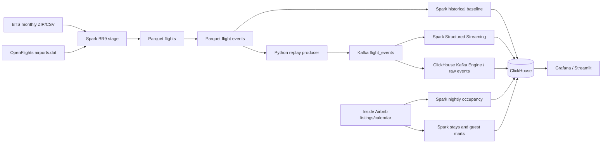

# 00 · Implementation plan

This project combines US BTS On-Time Performance data with Inside Airbnb data to study tourism pressure in six US destinations. The stack is Kafka → Spark batch and Structured Streaming → ClickHouse → Grafana and Streamlit. See [Purpose](03-purpose.md) for the input and output of each business requirement, [Dataset assessment](01-dataset-assessment.md) for measured coverage, and [Runbook](02-runbook.md) for commands.

## 1. Business questions and scope

| Destination | BTS airports | Inside Airbnb area | Time zone |
|---|---|---|---|
| Las Vegas | LAS | `nv/clark-county-nv` | America/Los_Angeles |
| Hawaii | HNL, OGG, KOA, LIH, ITO | `hi/hawaii` | Pacific/Honolulu |
| New Orleans | MSY | `la/new-orleans` | America/Chicago |
| Nashville | BNA | `tn/nashville` | America/Chicago |
| New York City | JFK, LGA, EWR | `ny/new-york-city` | America/New_York |
| San Francisco | SFO | `ca/san-francisco` | America/Los_Angeles |

The mapping is maintained in `jobs/common/destinations.py`. It is a deliberate cross-source mapping: BTS identifies airports, while Inside Airbnb identifies geographic areas. Hawaii covers the state and Clark County extends beyond Las Vegas city limits.

**BR9 — destination pressure.** For each airport and 15-minute local-time slot, compare arrivals with the historical p95 for the same weekday and slot. Separately, estimate the share of active Airbnb guest capacity unavailable for each night. Join the two indicators by destination and night. The alert thresholds are:

| Indicator | WATCH | WARNING | CRITICAL | EMERGENCY |
|---|---:|---:|---:|---:|
| Flight load: arrivals / `max(p95, 5)` | 100% | 120% | 150% | 200% |
| Airbnb unavailable capacity | 70% | 85% | 95% | — |

At least four arrivals with at least 60% delayed by 15 minutes or more produce a minimum WATCH flight level. The combined level is the greater of the two levels, plus one level when both are at least WARNING, capped at EMERGENCY. Arrivals before 06:00 local time are assigned to the previous accommodation night.

**BR10 — returning guests.** Treat one Airbnb review as a proxy for one stay. Group stays by the same reviewer no more than three days apart into one trip. A returning guest has at least two trips to the same destination. Cohorts start in January 2022 and exclude the two most recent months. RFM uses recency, trip frequency, and number of destinations; there is no historical spending amount.

## 2. Architecture and responsibilities



| Component | Role |
|---|---|
| Python ingest | Download BTS, Inside Airbnb, and OpenFlights files to `data/raw/`. |
| Spark batch | Parse CSV, normalize flight times, build baselines and occupancy, group stays into trips, and create marts. |
| Parquet lake | Store normalized flights, monitored-airport events, listing snapshots, and stays on the host filesystem. |
| Kafka | Hold replayed flight events; Spark and the ClickHouse Kafka Engine consume independently. |
| Spark Structured Streaming | Aggregate event-time 15-minute windows with a 30-minute watermark and score each window. |
| ClickHouse | Store dimensions, facts, marts, and serving views. |
| Grafana and Streamlit | Show operations dashboards and explore results. |

## 3. Processing sequence

1. **Download sources.** Fetch OpenFlights airports, BTS monthly ZIP/CSV files, and Inside Airbnb listings and calendars for every configured snapshot. Fetch reviews and neighbourhood GeoJSON only for the latest Airbnb snapshot.
2. **Profile sources.** `profiling.profile_sources` checks coverage, time zones, calendar horizons, and reviewer overlap. Results are written to `data/reports/`.
3. **Build dimensions (`br9_01`).** Write 12 airports and six destinations to ClickHouse. Missing time zones for monitored airports are fatal.
4. **Normalize flights (`br9_02`).** Select 29 BTS fields, attach airport time zones, calculate four UTC timestamps, and write monthly Parquet under `lake/flights`. Derive arrival, departure, cancellation, and diversion events at monitored airports under `lake/flight_events`. Refresh airport names and average arrivals in `dim_airport`.
5. **Build historical flow (`br9_03`).** Reserve the latest month for replay. Fill every airport × day × 15-minute slot with zero where no arrival occurred, then calculate p50 and p95 by airport, weekday, and local slot. Score historical windows using shared `aggregate_exprs()` and `score_windows()` functions. Record transitions into CRITICAL or above.
6. **Build occupancy (`br9_04`).** Keep listings with `availability_365 > 0`, `number_of_reviews_ltm > 0`, and `accommodates > 0`. For every snapshot, neighbourhood, and night, compute unavailable guest capacity divided by active guest capacity. The serving view selects the most recent snapshot within a 90-night horizon where possible, falling back to 120 nights with a low-confidence flag.
7. **Replay and stream (`stream`, `produce`).** Start Spark Structured Streaming first. The producer reads the latest Parquet event month, orders by event time, and sends events to Kafka. Spark groups 15-minute event-time windows and writes updates to `fact_airport_flow_15min`. The ClickHouse Kafka Engine also lands raw events for audit.
8. **Build BR10 (`br10_01` → `br10_02` → `br10_03`).** Read review IDs and dates without reviewer names or comments; group stays into trips; calculate guest repeat and RFM attributes; build destination, cohort, flow, segment, and annual marts.
9. **Serve and verify.** ClickHouse views combine BR9 indicators. Grafana and Streamlit read ClickHouse. Run `scripts/smoke_test.sh` for 20 data-quality checks.

## 4. Time conversion

BTS records local `hhmm` times and uses `FlightDate` for the **departure** date. Arrival may be on the next date. The pipeline avoids assigning `ArrTime` to `FlightDate`:

```text
sched_dep_utc = UTC(FlightDate + CRSDepTime at origin airport)
dep_utc       = sched_dep_utc + DepDelay minutes
sched_arr_utc = sched_dep_utc + CRSElapsedTime minutes
arr_utc       = sched_arr_utc + ArrDelay minutes
```

Converting the derived arrival back to destination local time matched the BTS `ArrTime` minute in 941,735 of 941,790 checked flights (99.99%). See the measured [dataset assessment](01-dataset-assessment.md).

## 5. ClickHouse model

| Group | Main tables and views | Writer |
|---|---|---|
| Dimensions | `dim_destination`, `dim_airport`, `dim_neighbourhood` | `br9_01`, `br9_02`, `br9_04` |
| Raw flight events | `kafka_flight_events`, `raw_flight_events` | ClickHouse Kafka Engine and materialized view |
| BR9 flow | `baseline_airport_slot`, `fact_airport_flow_15min`, `alert_airport_events` | `br9_03`, `stream` |
| BR9 occupancy | `fact_occupancy_night` | `br9_04` |
| BR9 serving | `v_city_flow_15min`, `v_occupancy_city_night`, `v_destination_15min`, `v_destination_live`, `v_destination_alerts`, `v_neighbourhood_next30` | ClickHouse views |
| BR10 core | `fact_stay`, `dim_guest` | `br10_01`, `br10_02` |
| BR10 marts | `mart_br10_city_overview`, `mart_br10_cohort`, `mart_br10_city_flow`, `mart_br10_rfm_segment`, `mart_br10_yearly` | `br10_03` |
| Operations | `pipeline_log`, `v_pipeline_status` | All Spark jobs |

ReplacingMergeTree is used where repeated writes may update the same key; queries that need deduplicated results use `FINAL`. Monthly ClickHouse partitions avoid excessive part counts. Small dimensions are broadcast to Spark executors. The Spark-to-ClickHouse writer uses HTTP blocks rather than JDBC.

## 6. Interpretation limits

- Flight counts are not passenger or tourist counts. Some flights carry business travelers or residents.
- Airbnb covers only part of the accommodation market; hotels are absent.
- `available = f` includes host-blocked nights, so unavailable capacity is an upper bound on bookings.
- Inside Airbnb collection scope changes between snapshots; do not compare total capacity across snapshots as a market-growth measure.
- BR10 includes only guests who wrote reviews. Removed listings can cause older reviews to disappear.
- The Kafka stream is a replay of published BTS history, not a live external flight feed.
