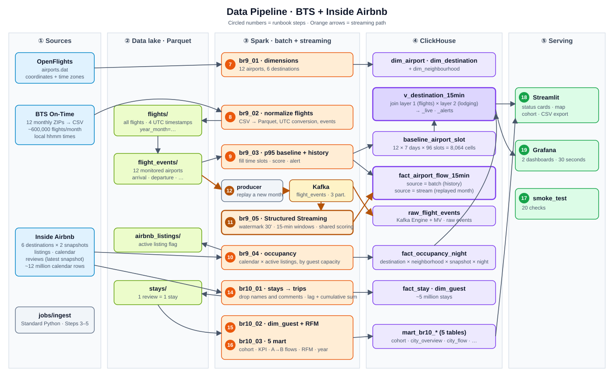

# 02 · Runbook — BTS + Inside Airbnb data pipeline

This guide starts the Docker stack, loads both source datasets, builds BR9 and BR10 outputs, replays flight events, and verifies the results. Run commands from the directory containing `docker-compose.yml` unless stated otherwise. The original measured run used WSL2 with 6.7 GB RAM and 12 CPU cores; times below are estimates, not guarantees.



## Before starting

The stack has nine services: Kafka, Kafka UI, ClickHouse, Spark master, Spark worker, Spark client, Grafana, Streamlit, and Prometheus. It uses about 6 GB of disk for downloaded and derived data, plus Docker volumes. Allocate at least 7 GB RAM to WSL2; 10 GB is preferable. If using Docker Desktop, enable WSL integration for your distribution.

The original `phuong-an-a` stack uses the same host ports. Stop it before starting this copy. Do not run expensive Spark jobs concurrently on a low-memory machine.

```bash
cd /path/to/your/checkout
chmod +x scripts/*.sh
```

Data paths printed inside containers begin with `/opt/data`. They refer to the same files as `data/` in this directory because Docker bind-mounts that folder. Raw data is downloaded by regular Python jobs in `spark-client`; Spark is used for profiling and transformations.

## Stage 1 · Infrastructure

### Step 1 · Start the stack

```bash
./scripts/up.sh
```

`up.sh` checks Docker, available memory, and host ports; builds images; starts services; waits for Kafka and ClickHouse; and creates the `flight_events` topic (three partitions, seven-day retention) and `flight_events_dlq` topic (one partition, 30-day retention). First-time builds need internet access for Python packages, Spark connectors, and the Grafana ClickHouse plugin. Use `--rebuild` to rebuild images or `--timeout 600` to wait longer for health checks.

Check `docker compose ps`: Kafka, ClickHouse, and Spark master should become healthy; Spark worker should appear in the Spark UI at http://localhost:8082. The stack does **not** download BTS or Airbnb data at this step.

### Step 2 · Create ClickHouse objects

```bash
./scripts/init_clickhouse.sh
```

This runs the SQL files in dependency order. It creates the `tourism` database, empty tables, materialized view, and serving views. It does not fill the business tables. Re-running is generally safe, though the Kafka Engine table and its materialized view are recreated. Use `--only 14_br9_serving.sql` to update the serving views after changing their SQL. `--drop-first` deletes the database and all stored ClickHouse data; use only when intentionally rebuilding it.

## Stage 2 · Download source data

The three download jobs below use ordinary Python inside the `spark-client` container. They write to `data/raw/` on the host.

| Source | Output | Approximate downloaded size |
|---|---|---:|
| OpenFlights airport reference | `data/raw/reference/airports.dat` | 1.1 MB |
| BTS monthly flights | `data/raw/bts/zip/` and `data/raw/bts/csv/` | 336 MB ZIP; 3.2 GB extracted CSV |
| Inside Airbnb | `data/raw/airbnb/<city_id>/<snapshot>/` | 850 MB |

### Step 3 · Airport reference

```bash
./scripts/run_job.sh airports
wc -l data/raw/reference/airports.dat
```

Expected: about 7,698 airport rows. OpenFlights supplies IATA codes, IANA time zones, and coordinates. BTS times are local to each airport and cannot be converted correctly to UTC without this reference. The 12 monitored airports must all have valid time zones; three additional small airports are covered by explicit overrides in `jobs/common/sources.py`.

### Step 4 · BTS monthly flights

```bash
./scripts/run_job.sh bts --months 12
```

The job finds the latest BTS-published month, downloads 12 monthly ZIP files, and extracts their CSV files. In the measured setup, these were July 2025 through June 2026, totaling 7,043,316 flights. The latest month is reserved for replay; prior months form the historical baseline. Already-downloaded files are skipped on retry.

To reproduce the original dates, use `./scripts/run_job.sh bts --from 2025-07 --to 2026-06`. To inspect the latest published month without downloading, use `./scripts/run_job.sh bts --latest`.

Basic checks:

```bash
find data/raw/bts/zip -name '*.zip' | wc -l
find data/raw/bts/csv -name '*.csv' | wc -l
for z in data/raw/bts/zip/*.zip; do unzip -tq "$z" || echo "BAD: $z"; done
```

For the original range, expect 12 ZIPs and 12 CSVs. Each CSV has approximately 500,000–650,000 flights and 110 source columns. Do not continue if a ZIP or CSV is incomplete.

### Step 5 · Inside Airbnb snapshots

```bash
./scripts/run_job.sh airbnb
```

For each of the six destinations, this downloads `listings.csv.gz` and `calendar.csv.gz` for both configured snapshots. It downloads `reviews.csv.gz` and `neighbourhoods.geojson` only for the latest snapshot. The original configuration yields 36 files across two snapshots per destination.

The snapshot distinction matters: calendars show future nights from the capture date, so a March snapshot is needed to study April and May 2026. Reviews contain historical records up to the snapshot, so the later snapshot avoids re-reading most earlier reviews. Reviews from removed listings may still be missing.

```bash
find data/raw/airbnb -type f | wc -l
find data/raw/airbnb -name '*.part'
find data/raw/airbnb -name '*.gz' -exec gzip -t {} +
```

Expect 36 files and no `.part` files. If a configured snapshot no longer exists, run `./scripts/run_job.sh airbnb --discover`, update `airbnb_snapshots` in `jobs/common/destinations.py`, and retry. Use `--city las-vegas` to download one destination only.

## Stage 3 · Profile sources

### Step 6 · Validate coverage and quality

```bash
./scripts/run_job.sh profile
```

This Spark job reads the source files and writes `data/reports/profile_sources.md` and JSON. Review its PASS/WARN findings before transforming data. The measured profile confirmed the 12 monitored airports, UTC conversion, two snapshots per destination, calendar overlap with BTS, and cross-destination reviewer IDs. Calendar dates far from a snapshot are often host-blocked; BR9 therefore prefers a 90-night horizon. See [Dataset assessment](01-dataset-assessment.md) for the original measurements.

## Stage 4 · BR9 batch

### Step 7 · Destination and airport dimensions

```bash
./scripts/run_job.sh br9_01
```

This Spark job writes six destinations to `tourism.dim_destination` and 12 monitored airports to `tourism.dim_airport`. At this point airport time zones and coordinates come from OpenFlights; BTS city names and arrival rates may still be empty. Step 8 refreshes the airport dimension with BTS values.

Check in ClickHouse:

```bash
docker compose exec -T clickhouse clickhouse-client --password clickhouse \
  -q "SELECT airport, city_id, timezone, bts_city_name FROM tourism.dim_airport FINAL ORDER BY airport"
```

### Step 8 · Normalize BTS flights and derive events

```bash
./scripts/run_job.sh br9_02
```

The job reads the monthly BTS CSV files, keeps 29 relevant source fields, assigns types, and calculates four UTC timestamps using OpenFlights time zones:

```text
sched_dep_utc = UTC(FlightDate + CRSDepTime in the origin time zone)
dep_utc       = sched_dep_utc + DepDelay
sched_arr_utc = sched_dep_utc + CRSElapsedTime
arr_utc       = sched_arr_utc + ArrDelay
```

It writes all normalized flights to `data/lake/flights/year_month=YYYY-MM/` as Parquet. It then keeps flights touching the monitored airports and writes arrival, departure, cancellation, or diversion events to `data/lake/flight_events/year_month=YYYY-MM/`. These lake paths are local Parquet folders, not ClickHouse tables. Finally, it refreshes `dim_airport` with BTS city names, CityMarketID, and average arrivals per day.

**Illustrative example:** A JFK → LAS flight has `FlightDate = 2026-06-10`, scheduled departure 22:00 New York time, departure delay 15 minutes, scheduled duration 330 minutes, and arrival delay 20 minutes. Its UTC timestamps are 11 June 02:00, 02:15, 07:30, and 07:50, respectively. It produces one `departure` event at JFK (02:15 UTC) and one `arrival` event at LAS (07:50 UTC). The LAS event belongs to the 07:45–08:00 UTC window, equivalent to 00:45–01:00 in Las Vegas. Directly pairing `FlightDate` with `ArrTime = 00:50` would assign the arrival to the wrong date.

One flight can produce two monitored-airport events, so event row count is not flight count. The original run produced about 1,927,577 event rows. Step 8 does **not** score destination pressure; Step 9 does that for historical events.

If `data/lake/flights/` already exists and only the monitored airport mapping changed, run `./scripts/run_job.sh br9_02 --events-only` to rebuild events without parsing CSV again. Use `--months 2026-07` to process a selected month. Full reprocessing is required after changing the UTC conversion logic.

### Step 9 · Historical p95 and flight-flow facts

```bash
./scripts/run_job.sh br9_03
```

The latest event month is set aside for streaming replay. Earlier months form the baseline and historical fact. The job fills an airport × day × 96-slot grid with zeros before computing p50 and p95 by airport, local weekday, and local 15-minute slot. Zero-filled slots prevent sparse overnight traffic from inflating p95. It writes `baseline_airport_slot` (12 × 7 × 96 = 8,064 rows), scored historical windows in `fact_airport_flow_15min`, and transitions into CRITICAL or above in `alert_airport_events`.

**Illustrative example:** For LAS on Thursdays at 00:45–01:00 local time, assume historical p95 is four arrivals. The denominator is `max(p95, 5) = 5`. Eight arrivals in such a window yield `8 / 5 × 100 = 160%`, which is CRITICAL (threshold 150%). June 2026 remains reserved for streaming in the default run; this example explains scoring, not a batch fact written for June.

Check that the baseline has 8,064 rows and that WARNING-or-higher windows remain uncommon. If fewer than three historical months precede the replay month, the job stops and asks for more BTS data.

### Step 10 · Airbnb nightly occupancy

```bash
./scripts/run_job.sh br9_04
```

The job joins `calendar` with listings from the same city and snapshot. A listing is active when `availability_365 > 0`, `number_of_reviews_ltm > 0`, and `accommodates > 0`. For each neighbourhood, snapshot, and night, it writes active guest capacity and unavailable guest capacity to `fact_occupancy_night`. It also writes neighbourhood locations and a listing Parquet lake used by BR10.

**Illustrative example:** Four active listings hold 2, 4, 3, and 1 guests. On one night the first three have `available = f` and the fourth has `available = t`. Active capacity is ten guests, unavailable capacity is nine guests, and estimated occupancy is 90%. `f` can mean either booked or host-blocked, so this is not a confirmed guest count.

ClickHouse chooses one suitable snapshot for each destination/night, preferring a snapshot within 90 nights of the stay. For an arrival at Las Vegas at 00:50 on 11 June, the serving view assigns the associated accommodation night to 10 June because arrivals before 06:00 belong to the previous night. If flight flow is CRITICAL and destination occupancy is WARNING, the combined level is EMERGENCY.

## Stage 5 · BR9 streaming replay

Use two terminals in the project root.

### Step 11 · Start the Spark stream in terminal 1

```bash
./scripts/run_job.sh stream
```

The stream loads `dim_airport` and `baseline_airport_slot` from ClickHouse once at startup, then listens to Kafka topic `flight_events`. Roughly every ten seconds it parses new JSON events, groups 15-minute **event-time** windows, applies a 30-minute watermark, scores using the same function as batch, and writes `source = 'stream'` rows to `fact_airport_flow_15min`. Leave this terminal running. An initially empty micro-batch is normal.

### Step 12 · Replay flights from terminal 2

```bash
./scripts/run_job.sh produce --start 2026-06-12 --days 2 --speedup 300
```

The Python producer reads the latest `lake/flight_events` month by default, orders events by their original timestamp, and sends them to Kafka. `--days 2` selects two UTC days, and `--speedup 300` compresses waiting between events by 300 times: one data day takes about five wall-clock minutes. Event timestamps are unchanged, so Spark windows still represent real 15-minute periods in the source month. Use `--month YYYY-MM` to select a month explicitly, `--dry-run --limit 3` to inspect messages, or `--speedup 0` to send as fast as possible.

**Start Step 11 first.** A new stream without a checkpoint starts at Kafka's latest offset, so messages sent before it starts may be skipped. With an existing checkpoint it resumes from its processed offset.

### Step 13 · Verify landing and scored facts

```bash
docker compose exec -T clickhouse clickhouse-client --password clickhouse \
  -q "SELECT event_type, count() FROM tourism.raw_flight_events GROUP BY event_type ORDER BY event_type"
docker compose exec -T clickhouse clickhouse-client --password clickhouse \
  -q "SELECT source, count(), max(window_ts) FROM tourism.fact_airport_flow_15min FINAL GROUP BY source"
```

ClickHouse Kafka Engine stores raw events independently of the Spark stream. In the measured two-day June replay, 10,799 events landed, including 5,068 arrivals; those arrivals matched the Spark window totals across the 12 airports. Stop the stream with Ctrl+C. Its checkpoint is retained so a restart continues from the last processed Kafka offset.

## Stage 6 · BR10 batch

### Step 14 · Reviews to stays and trips

```bash
./scripts/run_job.sh br10_01
```

The job reads only review IDs, listing IDs, reviewer IDs, dates, and city IDs from the latest snapshot. It excludes `reviewer_name` and `comments` immediately. It enriches reviews with listing attributes, treats a review as a stay, and groups stays by the same reviewer no more than three days apart into trips. It writes `data/lake/stays/` and ClickHouse `fact_stay`. The measured run produced 5,089,926 stays.

### Step 15 · Guest dimension and RFM

```bash
./scripts/run_job.sh br10_02
```

The job writes one `dim_guest` row per reviewer with trip count, destination count, first and last trip, repeat flags, recency, and RFM segment. A guest is a same-destination returner after at least two trips to one selected destination. RFM's M dimension is number of destinations, not spending. Recency is measured to the latest review date in the dataset rather than today's date.

### Step 16 · Five BR10 marts

```bash
./scripts/run_job.sh br10_03
```

The job builds the destination overview, monthly cohort matrix, destination transition matrix, RFM segment summary, and yearly trend. Cohorts start in January 2022 and exclude the two latest months to reduce missing-review bias. This is the most memory-intensive job; on a low-memory machine, stop the flight stream before running it.

## Stage 7 · Check results

### Step 17 · Data-quality checks

```bash
./scripts/smoke_test.sh
```

The SQL file contains 20 checks covering dimension counts, p95 ordering, aligned 15-minute windows, occupancy bounds, joins, unique stays, guest counts, cohort values, and latest pipeline status. Every row should say `PASS`. A failure means the measurement or required step needs inspection; do not assume it is only a display issue.

### Step 18 · Streamlit

Open http://localhost:8501. The home page shows table counts and latest job status. BR9 shows destination alerts, flow and occupancy charts, neighbourhood maps, and alert history. BR10 shows return KPIs, cohorts, onward destination flows, RFM segments, annual trends, and a guest CSV export.

### Step 19 · Grafana

Open http://localhost:3000 using the configured local administrator credentials. The two dashboards are provisioned automatically. The BR9 dashboard's original default time range points to the June 2026 replay; select a later range when replaying a later BTS month.

## Ongoing operation

### Stop and restart

```bash
./scripts/down.sh    # Stop containers; keep Docker volumes and host data
./scripts/up.sh      # Restart the stack
```

`down.sh --purge` removes Docker volumes, including ClickHouse and Kafka data; host `data/` files remain. Use it only when intentionally resetting the stack. Containers do not automatically start after a Windows restart.

### New BTS month: refresh `lake/flight_events` and replay

The stream reads Kafka, not BTS files or the Parquet lake directly. The following uses July 2026 as an example **only if BTS has published that month**:

1. Stop the stream with Ctrl+C if it is running. Download and normalize the month:

   ```bash
   ./scripts/run_job.sh bts --from 2026-07 --to 2026-07
   ./scripts/run_job.sh br9_02 --months 2026-07
   ```

   The job writes `lake/flights/year_month=2026-07/` and `lake/flight_events/year_month=2026-07/`, preserving other months. Use `bts --latest` first if the latest published month is unknown.

2. Refresh the baseline, then restart the stream in terminal 1:

   ```bash
   ./scripts/run_job.sh br9_03
   ./scripts/run_job.sh stream
   ```

   The previous replay month becomes history; the new latest month is reserved for replay. The stream must restart because it loads the baseline once.

3. Send events from terminal 2:

   ```bash
   ./scripts/run_job.sh produce --month 2026-07 --start 2026-07-12 --days 2 --speedup 300
   ```

   Remove `--start` and `--days` to replay the full month. Start the stream before the producer.

If no loaded Airbnb calendar covers the new BTS month, the flight indicator still works but occupancy is missing. Add an appropriate Airbnb snapshot to `destinations.py`, run `airbnb`, then `br9_04`. Airbnb updates are batch operations and are not sent to Kafka.

### Other partial reruns

| Change | Required sequence |
|---|---|
| BR9 flight thresholds | Edit `jobs/common/config.py`, run `br9_03`, restart `stream`. |
| BR9 occupancy thresholds | Update the serving SQL and `jobs/common/config.py`, then run `init_clickhouse.sh --only 14_br9_serving.sql`. |
| New Inside Airbnb snapshot | Add date to `destinations.py`, run `airbnb`, `br9_04`, and BR10 jobs if guest data must be refreshed. |
| New destination | Add mapping to `destinations.py`, download Airbnb files, run `br9_01`, `br9_02 --events-only`, `br9_03`, `br9_04`, and BR10 jobs. |
| Replay from earliest retained Kafka event | Stop stream; run `stream --reset --from-beginning`; note that Kafka retains the topic for seven days. |

A scheduled `bts → br9_02 → br9_03` command only prepares data and the baseline. It does not restart the stream or publish the new month's events.

## Troubleshooting

| Symptom | Check |
|---|---|
| A port is already in use | Stop the original stack or another process using the port. Check `docker ps`. |
| `spark-client` is not running | Run `./scripts/up.sh`, then inspect `docker compose logs spark-client`. |
| Out-of-memory or WSL allocation errors | Increase WSL RAM or swap; run heavy batch jobs separately and stop streaming during BR10 marts. |
| ClickHouse SQL view creation fails | Run the full `init_clickhouse.sh` in its defined file order; serving views depend on earlier tables. |
| `br9_03` has too few historical months | Download and stage at least three months before the replay month; six or more are recommended. |
| Monitored airport has no time zone | Verify its IATA code and OpenFlights data; add a documented override if needed. |
| Streaming receives no events | Start stream before producer; with retained events, use `stream --reset --from-beginning` after stopping it. |
| Raw Kafka events exist but no stream facts | Check Spark logs, baseline table, stream checkpoint, and whether the producer ran before stream startup. |
| BR9 occupancy is blank | Check `br9_04`, snapshot coverage, and the 120-night fallback horizon. |
| Streamlit cannot connect to ClickHouse | Check ClickHouse health, host settings, and `conf/clickhouse/config.d/listen.xml`. |
| Shell reports permission denied or `$'\r'` | Check executable bits and Unix LF line endings. |

The [dataset assessment](01-dataset-assessment.md) records measured results from the original run. The `data/` directory is ignored by Git, so run the download, profile, and transformation steps after cloning to generate local datasets and reports. Your counts may differ when source snapshots change.
