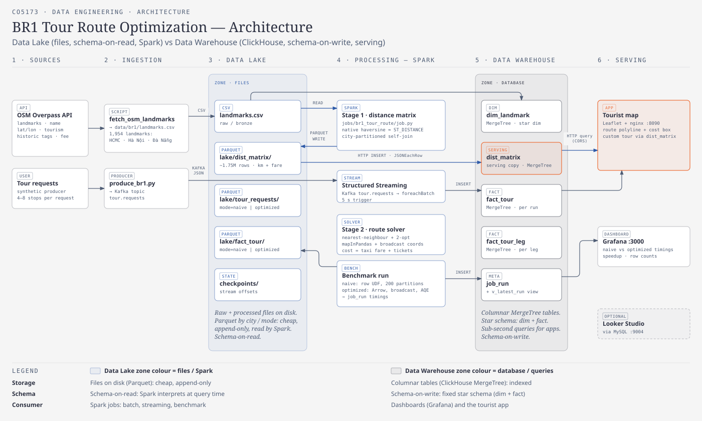

# BR1: Tour Route Optimization

**Business Requirement:** Tối ưu lịch trình di chuyển và tour (Phụ trách: Tiến). The platform takes the coordinates of tourist landmarks from OpenStreetMap and an estimated cost per stop (taxi fare plus entry ticket). Spark computes the shortest sequential route through each set of stops and adds up the expected cost of the tour. The tourist map shows the route and a cost summary.

---

## 1. Business requirement

**Input:** landmark coordinates (lat/lon) from OpenStreetMap, plus the estimated cost per stop: ticket price (`ticket_vnd`) and taxi fare between stops.

**Pipeline:** PySpark computes the pairwise distance matrix (the BigQuery equivalent is `ST_DISTANCE`, see Section 5), finds a short visiting order for each tour request, and accumulates the cost leg by leg.

**Serving:** a Leaflet route map plus an info box with the total tour cost, served to tourists from `serving/index.html`.

### What the business gets

- A precomputed set of suggested tours per city, filterable by number of stops and budget.
- A custom tour: a tourist picks up to 8 landmarks and gets the shortest route with its cost.
- A cost breakdown per leg (taxi fare and ticket for each stop).
- A Grafana view comparing naive and optimized processing time.

---

## 2. How it works in one paragraph

`scripts/fetch_osm_landmarks.py` writes 1,954 landmarks in three cities to `data/br1/landmarks.csv`. `ingestion/producers/produce_br1.py` generates seeded tour requests (4 to 8 stops each) and publishes them to Kafka topic `tour.requests`. `jobs/br1_tour_route/job.py` loads the landmarks, builds the distance matrix for all pairs within each city, and loads both into ClickHouse. It then streams the requests from Kafka, solves each one with nearest neighbour followed by 2-opt, and writes the results to `tour.fact_tour` and `tour.fact_tour_leg`. After the stream is running, the job runs a benchmark: the same requests are solved with a naive plan and with an optimized plan, and the timings go to `tour.job_run`. The tourist map and Grafana both read from ClickHouse.

---

## 3. Architecture: Data Lake vs Data Warehouse



The diagram shows two storage layers with different jobs. Both are used in this project; they are not alternatives.

### Data lake (files, Spark-facing)

The lake is the set of files under `data/br1/`:

- **Bronze:** `data/br1/landmarks.csv`, the raw OpenStreetMap extract, one row per landmark.
- **Lake (Parquet, gitignored):** Spark writes `data/br1/lake/dist_matrix/mode=optimized/city=…/`, `data/br1/lake/tour_requests/mode=naive|optimized/`, and `data/br1/lake/fact_tour/mode=naive|optimized/`.
- **Checkpoints:** `data/br1/lake/checkpoints/tour_requests/` holds the Structured Streaming progress for the request stream.

Properties:

- Cheap file storage, and the data stays in open formats.
- Schema-on-read: Spark infers or applies the schema when it reads.
- Partitioned by folder. `dist_matrix` is partitioned by city; the request and fact outputs are partitioned by run mode.
- Written by jobs in overwrite mode, so each run replaces its own output.
- Keeps raw and intermediate data, so results can be recomputed without re-fetching OSM.

In production this directory would live on S3, GCS or HDFS.

### Data warehouse (ClickHouse, consumer-facing)

The warehouse is the ClickHouse database `tour`, with tables defined in `sql/clickhouse/ddl_br1.sql`:

- `tour.dim_landmark`: the landmark dimension.
- `tour.fact_tour` and `tour.fact_tour_leg`: one row per solved tour and one row per leg.
- `tour.dist_matrix`: precomputed pairwise distances, used for serving.
- `tour.job_run`: timings of the benchmark stages.

Properties:

- Columnar MergeTree tables with a fixed schema and sort keys (`ORDER BY`).
- Schema-on-write: the DDL defines types before any data arrives.
- Indexed for fast analytical queries, so the map and Grafana can respond in well under a second.
- Read by dashboards and the tourist app, not by Spark.

In production this role would be played by BigQuery, Snowflake or ClickHouse Cloud.

### Comparison

| | Data lake (`data/br1/`) | Data warehouse (ClickHouse `tour`) |
|---|---|---|
| Storage | Files: CSV, Parquet, checkpoints | Columnar tables with sort keys |
| Schema | On read, applied by Spark | On write, fixed by DDL |
| Consumer | Spark jobs, re-runs and recomputation | Leaflet map, Grafana, SQL users |
| Cost and scale | Very cheap per TB; slow for ad-hoc queries | More expensive per TB; fast for queries |
| Typical tools | S3/GCS/HDFS, Parquet, Spark, Delta | BigQuery, Snowflake, ClickHouse |

Flow: sources (OpenStreetMap, synthetic requests) → ingestion (`fetch_osm_landmarks.py`, Kafka producer `produce_br1.py`) → lake (Parquet under `data/br1/lake/`) → Spark processing (`job.py`) → warehouse (ClickHouse, HTTP `JSONEachRow` inserts) → serving (Leaflet map on nginx :8090, Grafana on :3000).

---

## 4. Data flow

1. **`scripts/fetch_osm_landmarks.py`** queries the Overpass API for three bounding boxes (hcmc, hanoi, danang), keeps named elements, and writes `data/br1/landmarks.csv`. Columns: `osm_id,name,category,city,lat,lon,ticket_vnd`.
2. **`ingestion/producers/produce_br1.py`** reads `landmarks.csv`, groups stops by city (cities with at least 4 stops), and publishes one JSON request per message to Kafka topic `tour.requests`. Stops are sampled with `random.Random(BR1_SEED)`.
3. **`jobs/br1_tour_route/job.py`, load:** `spark.read` loads `landmarks.csv`, which is also inserted into `dim_landmark` (ClickHouse). The job then starts the Kafka stream right away, so `start.py`'s readiness wait is short.
4. **Stream:** `readStream` from `tour.requests`, `from_json` with `REQUEST_DDL`, then `mapInPandas(solve_batches)` solves each request (nearest neighbour + 2-opt) using the broadcast landmark coordinates. Malformed records, unknown cities and unknown stop ids are dropped, and the dropped count is logged. `foreachBatch` inserts into `tour.fact_tour` and explodes the legs into `tour.fact_tour_leg`. Trigger: 5 seconds.
5. **Distance matrix:** the job builds the distance matrix for all ordered pairs within each city with native Spark expressions (haversine, `EARTH_KM = 6371.0088`), writes `lake/dist_matrix/mode=optimized/` partitioned by city, and inserts into `tour.dist_matrix`. It runs while the stream is already live.
6. **Benchmark:** the same requests are generated twice from a deterministic hash (`F.hash(request_id, seed, i)`), once per mode. Each mode writes `lake/tour_requests/mode=…`, solves them, and writes `lake/fact_tour/mode=…`. Stage timings go to `tour.job_run`.

Kafka message example (one request):

```json
{"request_id": 0, "city": "hcmc", "stop_ids": ["n11494677859", "w1214284149", "w1154085685", "w1308720666"], "requested_at": "2026-10-10T08:00:00Z"}
```

---

## 5. Algorithm and cost model

**Distance (haversine).** With φ and λ in radians and R = `EARTH_KM = 6371.0088` km:

```
h = sin²((φ2 − φ1)/2) + cos φ1 · cos φ2 · sin²((λ2 − λ1)/2)
d = 2 · R · asin(√h)
```

The Spark job (`job.py`, `dist_matrix` stage) implements this with `F.sin`, `F.cos`, `F.asin` and `F.sqrt`. The BigQuery equivalent is `ST_DISTANCE(ST_GEOGPOINT(lon, lat), ST_GEOGPOINT(lon, lat)) / 1000`, shown in `sql/bigquery/br1_tour_distance.sql`. That file is documentation only and is not executed in this repo. ST_DISTANCE uses a spherical Earth model, so the two values agree closely but not necessarily to the last digit.

**Route.** The route is an open path that starts at the first stop. The Spark solver uses nearest neighbour from node 0, then 2-opt until no swap shortens the path (`solve_order`). The browser solves custom tours of up to 8 stops by brute force over all permutations of the remaining stops (7! = 5,040 at most), with ties broken by fare.

**Fare per leg.** `leg_fare_vnd = 11,000 + 15,000 × km` (VND), constants `FARE_FLAG_VND` and `FARE_PER_KM_VND` in `job.py`. Python rounds with `floor(x + 0.5)`; the Spark matrix uses `F.round`.

**Ticket per stop.** Taken from the OSM `fee` and `charge` tags: `fee=no` gives 0; otherwise `charge` must be an integer, optionally with thousands separators, and is used as is. Any other `charge` value is ignored. If no usable tag applies, the category default from `TICKET_DEFAULT_VND` in `fetch_osm_landmarks.py` is used:

| Category | Default ticket (VND) |
|---|---|
| museum | 40,000 |
| gallery | 30,000 |
| zoo | 60,000 |
| theme_park | 150,000 |
| aquarium | 100,000 |
| attraction | 20,000 |
| historic | 30,000 |
| viewpoint, artwork, place_of_worship | 0 |

**Cumulative cost.** `total_cost_vnd = total_fare_vnd + total_ticket_vnd`, where `total_ticket_vnd` is the sum of the tickets of all stops, including the start. In `fact_tour_leg`, `cum_cost_vnd` at seq 0 is the start stop's ticket. Each later leg adds its fare plus the ticket of the stop it arrives at. The last `cum_cost_vnd` equals `total_cost_vnd`.

### Worked example (request 0, ClickHouse, run from this workspace)

Query: `SELECT … FROM tour.fact_tour_leg WHERE request_id = 0 ORDER BY seq`. Request 0 is an hcmc tour with 4 stops and no entry tickets.

| seq | From | To | Stop name | Leg km | Leg fare (VND) | Ticket (VND) | Cum. cost (VND) |
|---|---|---|---|---|---|---|---|
| 0 | n11494677859 | n11494677859 | Mohandas Gandhi | 0 | 0 | 0 | 0 |
| 1 | n11494677859 | w1214284149 | Nhà thờ Tin Lành Bàn Cờ | 1.506 | 33,595 | 0 | 33,595 |
| 2 | w1214284149 | w1154085685 | Dòng Đức Bà - Giáo Xứ Regina Mundi | 1.644 | 35,660 | 0 | 69,255 |
| 3 | w1154085685 | w1308720666 | Chùa Kỳ Quang 2 | 6.630 | 110,448 | 0 | 179,703 |

Total: 9.780 km, fare 179,703 VND, tickets 0, **total 179,703 VND**. Check: 33,595 + 35,660 + 110,448 = 179,703.

---

## 6. Big Data processing optimization

This section compares two implementations of the same solver, selected by `set_mode()`. `NAIVE_CONF` and `OPTIMIZED_CONF` in `job.py` hold the Spark settings.

| Technique | Naive | Optimized | Why it matters |
|---|---|---|---|
| Per-request solve | Python row UDF `F.udf(naive_plan)` | `mapInPandas(solve_batches)` with numpy haversine on each batch | The UDF pickles and calls Python once per row; the batch version runs vectorised numpy per batch. |
| Distance source | Shuffle join of request edges to `dist_matrix` parquet | Coordinates broadcast with `sc.broadcast(coords)`; distances computed locally | Removes a shuffle of about 1.75M pair rows per run. |
| Request building | Shuffle joins on city and idx | `F.broadcast(city_n)` and `F.broadcast(stop_lm)` | Small lookup tables are sent to each executor instead of shuffled. |
| Adaptive execution | AQE off, `spark.sql.shuffle.partitions=200` | AQE on, coalesce partitions, 8 shuffle partitions | Small partitions are merged, so the optimized run does not start 200 tiny tasks. |
| Data transfer to Python | Row-at-a-time pickle | Arrow batches (`spark.sql.execution.arrow.pyspark.enabled=true`) | Arrow moves whole columns between the JVM and Python with no per-row serialization. |
| Distance matrix build | Not part of the per-request path; built once in the warm-up | Native Catalyst expressions (`F.sin`, `F.asin`, …) over the 1.75M-pair join | Codegen runs the arithmetic in the JVM with no Python round trip. |
| ClickHouse writes | Not used by the benchmark | `foreachPartition` posts 20,000-row `JSONEachRow` batches from each executor | Inserts run in parallel from executors; the driver does not collect the 1.75M rows. |
| Scheduling | Default | `spark.scheduler.mode=FAIR` | Stream micro-batches and benchmark jobs share the session without one blocking the other. |
| Request generation | Deterministic hash on `request_id`, `seed` and index | Same | Both modes see identical requests, so timings and outputs compare fairly. |

### Measured results

Run: 20,000 requests, executor 1 core and 512 MB, Spark 4.0 standalone. Source: `tour.v_latest_run`.

| Stage | Naive (s) | Optimized (s) | Rows |
|---|---|---|---|
| requests | 14.514 | 1.100 | 20,000 |
| solve | 50.155 | 2.520 | 20,000 |
| **total** | **64.669** | **3.620** | 20,000 |

Speedup: 64.669 / 3.620 ≈ **17.9×**.

Warm-up (optimized only):

| Stage | Seconds | Rows |
|---|---|---|
| landmarks | 5.926 | 1,954 |
| dist_matrix | 4.010 | 1,746,644 |
| sink_clickhouse | 21.107 | 1,748,598 (landmarks plus matrix) |

Reproduce with `BR1_BENCH_REQUESTS=20000 make demo-br BR=1`. The timings also appear in Grafana panel "Speedup (naive / optimized, total)" and "Thời gian từng stage: naive vs optimized (giây)" on the BR1 dashboard.

The figures above were measured while other work shared the Spark cluster. An isolated benchmark (3 repetitions, nothing else on the cluster) gives a median speedup of 16.75x (naive 52.066 s, optimized 3.064 s, same 20,000 tours). See [../result/br1/result-benchmark.md](../result/br1/result-benchmark.md).

---

## 7. ClickHouse schema

Source: `sql/clickhouse/ddl_br1.sql`. Database `tour`.

**`tour.dim_landmark`** (MergeTree, `ORDER BY (city, osm_id)`): one row per landmark. `osm_id` (OSM element id, `n…`/`w…`/`r…`), `name`, `category`, `city` (`hcmc`, `hanoi`, `danang`), `lat`, `lon`, `ticket_vnd`.

**`tour.dist_matrix`** (MergeTree, `ORDER BY (city, from_id, to_id)`): all ordered pairs within a city. `dist_km` is `Float32`, so values are rounded to about 7 significant digits. `fare_vnd` is the leg fare.

**`tour.fact_tour`** (ReplacingMergeTree, `ORDER BY (city, n_stops, total_cost_vnd, request_id)`): one row per solved request. The stream is at-least-once, so a redelivered micro-batch can insert a request twice; the engine collapses duplicates on the sort key during merges. Use `FINAL` for exact counts, for example `SELECT count() FROM tour.fact_tour FINAL`. `stop_ids`, `stop_names`, `lats` and `lons` are stored in visiting order; `total_km`, `total_fare_vnd`, `total_ticket_vnd`, `total_cost_vnd`.

**`tour.fact_tour_leg`** (ReplacingMergeTree, `ORDER BY (request_id, seq)`): one row per leg, including seq 0 (the start). Duplicates from redelivery collapse the same way; use `FINAL` for exact counts. `from_id`, `to_id`, `to_name`, `leg_km`, `leg_fare_vnd`, `ticket_vnd` (of the arrival stop), `cum_cost_vnd`.

**`tour.job_run`** (MergeTree, `ORDER BY (ran_at, run_mode, stage)`): one row per benchmark stage with `run_mode`, `stage`, `seconds`, `rows`, `requests`, `ran_at`.

**View `tour.v_latest_run`:** all stages for the latest `ran_at` of each `run_mode`. This is what Grafana reads.

Star-schema note: the only true dimension is `dim_landmark`. `fact_tour` stores its stops as arrays for direct display, so joins to the dimension are rarely needed.

---

## 8. Data sources

**OpenStreetMap via Overpass API.** The query asks for `tourism` in {attraction, museum, gallery, zoo, theme_park, aquarium, viewpoint, artwork}, any `historic` element, and `amenity=place_of_worship` with a `name`. Endpoints are `overpass-api.de` and `overpass.kumi.systems`, each tried twice. Bounding boxes:

| City | Bounding box (south, west, north, east) | Rows kept |
|---|---|---|
| hcmc | 10.65, 106.55, 10.90, 106.85 | 1,129 |
| hanoi | 20.95, 105.75, 21.10, 105.90 | 671 |
| danang | 15.95, 108.10, 16.15, 108.30 | 154 |
| **Total** | | **1,954** |

Category counts in `landmarks.csv`: place_of_worship 1,412; historic 167; attraction 151; artwork 121; museum 68; gallery 16; viewpoint 8; theme_park 5; zoo 3; aquarium 2; information 1.

**Licence:** OpenStreetMap data is © OpenStreetMap contributors, licensed under ODbL. Attribution is required when the data is shown publicly.

**Ticket estimate caveat:** ticket prices are not official. They come from OSM tags where present and otherwise from the flat category defaults above. They are estimates for demonstration, not current prices.

**Synthetic tourist requests.** No public dataset of tour requests exists. The producer generates them with a fixed seed (`BR1_SEED`, default 42), choosing a city at random and sampling 4 to 8 landmarks from it. Seeding makes runs reproducible.

---

## 9. Runbook

### Prerequisites

- Docker Desktop running.
- `.env` in the repo root with `CLICKHOUSE_PASSWORD` set (copy from `.env.example`).
- `data/br1/landmarks.csv` present. It is committed; to refresh it, run `python3 scripts/fetch_osm_landmarks.py`. The script always fetches all three cities.

### Run

```bash
make demo-br BR=1
```

`scripts/start.py` does the following, in order:

1. Builds the `spark-local` image and starts `clickhouse`, `kafka`, `tour-map`, `spark-local`, `grafana`, `prometheus`, `spark-master` and `spark-worker`. Waits for the ClickHouse and Kafka healthchecks.
2. Runs `scripts/topics.py --reset`, which recreates the topics, including `tour.requests`.
3. Applies `sql/clickhouse/ddl_br1.sql` and truncates the `fact_*` tables.
4. Submits `jobs/br1_tour_route/job.py` to the Spark master. Driver and executor memory are 512 MB (`SPARK_DRIVER_MEMORY`, `SPARK_EXECUTOR_MEMORY`), `spark.cores.max=1`, and `spark.sql.shuffle.partitions=4` by default. `start.py` waits up to `SPARK_READY_TIMEOUT` (default 180 s) for the stream to start.
5. Starts `ingestion/producers/produce_br1.py` with `PRODUCER_INTERVAL` and optional `PRODUCER_LIMIT`.

Logs: `logs/demo/br1-spark.log` and `logs/demo/br1-producer.log`. Ctrl+C stops the producer; see Stopping below to stop the Spark job.

### Environment knobs

| Variable | Read by | Default | Effect |
|---|---|---|---|
| `BR1_BENCH_REQUESTS` | job | `20000` | Requests in the benchmark. `0` skips it. |
| `BR1_SEED` | job, producer | `42` | Seed for requests and stop sampling. |
| `BR1_LANDMARKS` | job, producer | `/opt/data/br1/landmarks.csv` | Landmark CSV path inside the container. |
| `BR1_LAKE` | job | `/opt/data/br1/lake` | Lake and checkpoint root. |
| `BR1_MAX_LANDMARKS_PER_CITY` | job | `0` (all) | Limit landmarks per city for quick runs. |
| `BR1_MAX_OFFSETS` | job | `2000` | Kafka records per 5-second micro-batch. |
| `SPARK_READY_TIMEOUT` | `start.py` | `180` | Seconds to wait for the stream. |
| `PRODUCER_LIMIT` (make var) | producer `--events` | unset (20,000) | Number of requests to publish. |
| `PRODUCER_INTERVAL` (make var) | producer `--interval` | `0` | Seconds between requests. |

`start.py` forwards any variable beginning with `BR<n>_` into the containers, so `BR1_*` set on the host takes effect.

### Verify

```sql
-- Row counts
SELECT count() FROM tour.dim_landmark;      -- 1954
SELECT count() FROM tour.dist_matrix;       -- 1746644
SELECT count() FROM tour.fact_tour FINAL;

-- Benchmark timings
SELECT * FROM tour.v_latest_run ORDER BY run_mode, stage;

-- One tour's legs
SELECT seq, to_name, leg_km, leg_fare_vnd, ticket_vnd, cum_cost_vnd
FROM tour.fact_tour_leg WHERE request_id = 0 ORDER BY seq;
```

Run them with:

```bash
docker exec clickhouse clickhouse-client --password "${CLICKHOUSE_PASSWORD:-clickhouse}" --query "SELECT count() FROM tour.fact_tour FINAL"
```

### Reset and replay

`start.py` truncates the `fact_*` tables, and the job itself truncates `dim_landmark`, `dist_matrix`, `fact_tour` and `fact_tour_leg` and deletes `lake/checkpoints/tour_requests` at start. No manual cleanup is needed for a fresh run.

**Stale Kafka volume.** If `kafka` exits with `Invalid cluster.id in: /var/lib/kafka/data/meta.properties`, run `docker compose down`, then `docker volume rm co5173-data-engineering_kafka-data`. If Grafana provisioning fails, also remove `co5173-data-engineering_grafana-data`.

**Stopping:** Ctrl+C in `make demo-br` stops the producer but the Spark driver keeps running inside `spark-local` (the `docker exec` client is what receives the signal). Run `docker exec spark-local pkill -f job.py` to stop the job, then `make down` to stop the stack.

---

## 10. Serving

**Tourist map:** http://localhost:8090 (nginx `tour-map` serving `serving/`, read-only). The page uses Leaflet 1.9.4 and queries ClickHouse over HTTP on port 8123.

Two modes:

- **A. Suggested tours:** choose a city, optionally a number of stops and a maximum budget. The page runs `SELECT … FROM tour.fact_tour WHERE city = … ORDER BY total_cost_vnd LIMIT 20`. Selecting a tour loads its stops from `fact_tour` and its legs from `fact_tour_leg`.
- **B. Custom tour:** search landmarks in the chosen city, pick up to 8 (the first is the start), then press "Tối ưu lộ trình". The page reads `tour.dist_matrix` for the selected pairs and brute-forces the shortest open path in the browser.

The info box shows total km, total fare, total tickets, total cost, and each leg with its cumulative cost.

Connection settings come from URL parameters: `?ch=` (ClickHouse HTTP URL, default `http://localhost:8123`), `?user=` (default `default`), `?pw=` (default `clickhouse`).

**Grafana:** http://localhost:3000/d/br1-tour (login `admin` / `admin`). Dashboard "BR1 Tour Route Optimization" panels:

1. Speedup, naive / optimized total (stat).
2. Distance pairs in `dist_matrix` (stat).
3. Optimized tours in `fact_tour` (stat).
4. Stage time, naive vs optimized (bar chart).
5. Average tour cost by city and number of stops (bar chart).
6. Landmark map from `dim_landmark` (geomap).

**Security note:** the tourist page queries ClickHouse directly with the default user and its password, which are visible to anyone who opens the page. This is acceptable for a local demo only. For anything public, put a read-only ClickHouse user or an API proxy in front of the data.

### Business queries in Grafana: BR1 Tour finder

The business queries run in Grafana: http://localhost:3000/d/br1-finder (`grafana/dashboards/br1-tour-finder.json`, uid `br1-finder`). The dashboard variables are the inputs. The panels query `tour.fact_tour`, `tour.fact_tour_leg` and `tour.dim_landmark`.

**Inputs:**

- City.
- Stops (4-8, multi-select).
- Max budget (VND: 300k to 3M, or No limit).
- Includes a stop of type (landmark category).
- Must visit (landmark names, multi-select). A tour must contain all of them.
- Tour # (the matching tours, cheapest first; the default is the cheapest).

**Panels:**

- Stats: Matching tours, Cheapest tour, Median tour cost, Shortest tour.
- "Tours within budget, cheapest first": click a tour number to select it.
- "Cheapest tour for each number of stops".
- "Selected tour": leg-by-leg cost, and the route on the map.
- Average cost split (transport vs tickets) by number of stops.

**Questions it answers:**

- What is the cheapest 5-stop tour in Hanoi under 500,000 VND?
- Which tours in Da Nang include a place of worship?
- Which tours in Ho Chi Minh City pass through Miếu Ngũ Hành?

**Checked against direct SQL** (measured 2026-11-08, with the BR1 stream still filling: 8k of 20k requests, so counts change per run):

- Hanoi, 5 stops, budget 500,000 VND: 1,316 tours in Grafana and in `SELECT count() FROM tour.fact_tour FINAL WHERE city='hanoi' AND n_stops=5 AND total_cost_vnd<=500000`. Cheapest 118,053 VND, median 314,336 VND, shortest 3.11 km.
- HCMC, must visit "Miếu Ngũ Hành": 244 tours. The cheapest (request 16128) has 4 stops for 160,273 VND, and its leg table's running total ends at that cost.
- Da Nang, type `place_of_worship`: 6,322 of 6,532 tours.
- HCMC defaults: 6,730 tours, cheapest 99,530 VND.

**Query time** (ClickHouse `system.query_log`, all dashboard queries): median 7 ms, max 89 ms, at most 40,000 rows read.

**Limits:**

- Requests are random, so two "Must visit" landmarks rarely appear in one tour and usually return nothing.
- The tour table shows at most 100 rows.
- `fact_tour` has no request time, so the time picker is hidden.
- The map's "fit to data" did not zoom in during a headless-browser check. Use the mouse wheel if it opens zoomed out.

**Check:** `python3 tests/br5/check_dashboards.py --br 1` runs each panel query through Grafana's API with the default inputs. Result on 2026-11-08: 19 queries, 0 failed, 0 empty.

### Metrics: Grafana + Prometheus

Grafana reads two metric sources:

- **ClickHouse (business and benchmark metrics):** `tour.v_latest_run`, `tour.fact_tour`, `tour.dist_matrix`, `tour.dim_landmark`. These are the tour counts, costs and naive vs optimized timings.
- **Prometheus (runtime and streaming metrics):** Spark's streaming query metrics (input rate, processing rate, batch latency, state rows) and executor memory, GC time and completed tasks.

Scrape chain: `start.py` passes `spark.ui.prometheus.enabled=true`, `spark.sql.streaming.metricsEnabled=true`, `spark.metrics.namespace=br<N>` and the PrometheusServlet sink to every BR driver, so each driver serves `/metrics/prometheus` on its UI port. Prometheus scrapes the `spark-driver` job (`/metrics/prometheus/`) and the `spark-executors` job (`/metrics/executors/prometheus/`) on `spark-local:4040`–`4043`, one port per running BR. Unused ports show as down in Prometheus, which is expected. The BR1 and BR2 dashboards read these series through the `prometheus` datasource.

Metric names come from the query name, `tour_requests` for BR1. For example, `metrics_br1_driver_spark_streaming_tour_requests_latency_Value`. The dashboards have a row "Spark streaming (Prometheus)" with these panels:

| Panel | Source | Query |
|---|---|---|
| Input rows/s | Prometheus | `metrics_br1_driver_spark_streaming_tour_requests_inputRate_total_Value` |
| Processed rows/s | Prometheus | `metrics_br1_driver_spark_streaming_tour_requests_processingRate_total_Value` |
| Batch latency (ms) | Prometheus | `metrics_br1_driver_spark_streaming_tour_requests_latency_Value` |
| Executor memory used | Prometheus | `metrics_executor_memoryUsed_bytes{application_name="br1-tour-route"}` |
| Speedup (naive / optimized, total) | ClickHouse | `SELECT maxIf(seconds, run_mode='naive') / maxIf(seconds, run_mode='optimized') FROM tour.v_latest_run WHERE stage = 'total'` |
| Average tour cost by city and stops | ClickHouse | `SELECT city, n_stops, round(avg(total_cost_vnd)) AS avg_cost_vnd FROM tour.fact_tour GROUP BY city, n_stops` |

Raw endpoints: Prometheus UI http://localhost:9090 (try `metrics_br1_driver_spark_streaming_tour_requests_latency_Value`), target health http://localhost:9090/api/v1/targets.

---

## 11. Assumptions and limitations

- **Straight-line distance.** Haversine ignores roads, so routes are shorter than real travel. No road network or OSRM is used.
- **Flat taxi tariff.** The fare is 11,000 VND flag fall plus 15,000 VND per km, with no city or time variation.
- **Ticket estimates.** Tickets come from OSM tags or category defaults. They are not official prices.
- **Synthetic demand.** Requests are generated, not observed.
- **Single-node benchmark.** Timings come from one Spark worker with 1 core and 512 MB executors. They show relative differences, not production throughput.
- **Heuristic solver.** Nearest neighbour plus 2-opt is not optimal for more than about 8 stops. The browser's brute force is exact but only feasible for 8 stops or fewer.
- **Shared worker.** If BR1 and BR2 run together (`make demo-br BR=1,2`), both apps share one 2-core, 2 GB worker, each with `spark.cores.max=1`. The BR1 benchmark and its stream then share one core, so timings are slower than in a solo run.
- **Float32 rounding.** `dist_km` and `leg_km` are `Float32` in ClickHouse, so tiny differences from the Spark double values are expected.

---

**Generated:** 2026-10-10 | **Audience:** CO5173 team and lecturer
