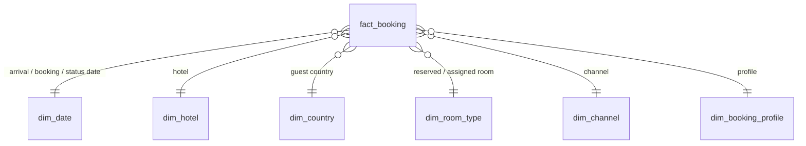

# BR5 Plan: Data Model (Star Schema)

Shared by every BR5 plan: [plan-data-import.md](plan-data-import.md) fills these tables, and the analysis and monitoring plans read them. Business rules come from [spec.md](../../spec/br5/spec.md).

## 1. Layers

```
hotel_bookings.csv ──Spark import job──► br5.raw_booking          landing: the file as-is, one wide table
                                    └──► br5.dim_* + br5.fact_booking   star schema: the main model for analysis
                                                      └──(analysis plan)──► aggregate tables / dictionaries
br5.pipeline_runs                                     run history for imports and analysis runs
```

- **Database `br5`.** All BR5 tables live in their own ClickHouse database.
  - BR4 already has a `default.fact_bookings` table, so names would clash otherwise.
  - Fresh mode can then drop "BR5 data" in one clear place.
- **Raw layer: `raw_booking`.** An exact typed copy of the file, kept for three reasons:
  - The spec asks that the data be loaded as-is.
  - The star schema can be rebuilt from it without re-reading the CSV.
  - It is the "single wide table" baseline in the query benchmarks.
- **Star layer.** The model the app queries.
  - **No row is dropped and no value is changed.** Every source row becomes exactly one fact row.
  - A missing value points to an "Unknown" dimension row instead of being removed.
  - Cleaning rules (canceled, zero nights, duplicates and so on) stay as filters applied at each analysis run, as the spec requires. The fact table carries every column those filters need.

## 2. Star schema

**Grain of the fact table:** one booking (one row of the file; with the multiplier, one row per copy).



### Dimensions

| Table | Rows | Columns | Source columns |
|---|---|---|---|
| `dim_date` | ~1,600 (Jun 2013 – Sep 2017) | `date_key` (YYYYMMDD), date, year, quarter, month, month_name, iso_week, day_of_month, day_of_week, is_weekend | Generated to cover every date used. Played in 3 roles: **arrival** date, **booking** date (arrival − lead time) and **status** date |
| `dim_hotel` | 2 | `hotel_key`, hotel_name | hotel |
| `dim_country` | ~178 | `country_key` (0 = Unknown), country_code, country_name | country + `data/br5/countries.csv` |
| `dim_room_type` | 12 | `room_type_key`, room_type_code | reserved_room_type and assigned_room_type (2 roles) |
| `dim_channel` | 26 | `channel_key`, market_segment, distribution_channel | The "Where" part of a recommendation |
| `dim_booking_profile` | 108 | `profile_key`, meal, deposit_type, customer_type, is_repeated_guest, reservation_status | A *junk dimension*: low-value flags grouped into one small table, so they don't widen the fact table |

- **Keys are small integers assigned deterministically.** Natural values are sorted and numbered from 1, and 0 is reserved for Unknown. The same file always gives the same keys, which keeps runs reproducible (spec section 4).
- **The two room-type columns share `dim_room_type`.** Assigned room types include `I` and `K`, which never appear as reserved types.

### Fact: `fact_booking`

| Group | Columns |
|---|---|
| Dimension keys | arrival_date_key, booking_date_key, status_date_key, hotel_key, country_key, reserved_room_type_key, assigned_room_type_key, channel_key, profile_key |
| Kept on the fact (no attributes worth a table) | agent_id, company_id (Nullable), arrival_week_number (the file's own week number: it differs from the ISO week in 64k rows, so it is kept as-is) |
| Measures | is_canceled, lead_time, weekend_nights, week_nights, **stay_nights** (derived: weekend + week), adults, children (Nullable), babies, adr, previous_cancellations, previous_bookings_not_canceled, booking_changes, days_in_waiting_list, required_car_parking_spaces, total_of_special_requests |
| Flags (derived at import) | **is_duplicate**: the row is an exact copy of an earlier row in the file (31,994 rows). Computed before the multiplier, so synthetic copies aren't marked as duplicates |
| Lineage | import_id, source_row, copy_no |

**Physical layout (starting point):**
- `MergeTree`
- `PARTITION BY` arrival year
- `ORDER BY (hotel_key, country_key, reserved_room_type_key, arrival_date_key)`. This matches the Promotion Finder's filters (hotel, country, room type) and its grouping by month.
- Dimensions are `MergeTree ORDER BY <key>`.
- Other layouts can be benchmarked later (config spec, C9).

### Raw: `raw_booking`

- The 32 source columns, typed as listed in the import plan, plus `import_id`, `source_row` and `copy_no`.
- `ORDER BY (hotel, arrival_date_year, source_row)`.

## 3. What the model gives the optimization story

The same promotion question can be answered on several models. [plan-pipeline.md](plan-pipeline.md) uses the star schema (Spark, or ClickHouse SQL as the alternative engine); the other variants are left for the benchmark step:

| Variant | Where | What it shows |
|---|---|---|
| Wide table | `raw_booking` | Baseline: no joins, but larger rows and text values |
| Star schema with joins | `fact_booking` ⋈ dims | Standard warehouse model. In ClickHouse, the join strategy and the join order matter |
| Star schema with dictionaries | `dictGet` on dims | ClickHouse's in-memory lookups as a replacement for joins |
| Pre-aggregated | Monthly demand table (analysis plan) | The cheapest query, at the cost of a build step |

Spark work that the model creates, which the import job logs and times:
- **Broadcast vs. shuffle join** when the fact is built from the raw data plus the dimensions. All dimensions are tiny, so this is controlled by `autoBroadcastJoinThreshold`.
- **Data skew:** Portugal (PRT) is 41% of all bookings, so work keyed by country is skewed. This is a real case for AQE skew handling.
- **Caching:** the typed input feeds 8 outputs (raw table, 6 dimensions, fact), so caching it saves re-reading and re-parsing the file.
- **Window and shuffle cost:** the `is_duplicate` check partitions by all 32 columns.

## 4. Checks (run at the end of every import)

- `count(fact_booking) = count(raw_booking) = rows read × multiplier`.
- Every fact key exists in its dimension (anti-join count = 0). Only a missing country points to Unknown (488 rows ×N).
- `sum(adr)` and `sum(stay_nights)` are equal in the raw and fact tables.
- `is_duplicate` count = 31,994 × multiplier (the flag is computed once on the original rows and carried into each copy).
