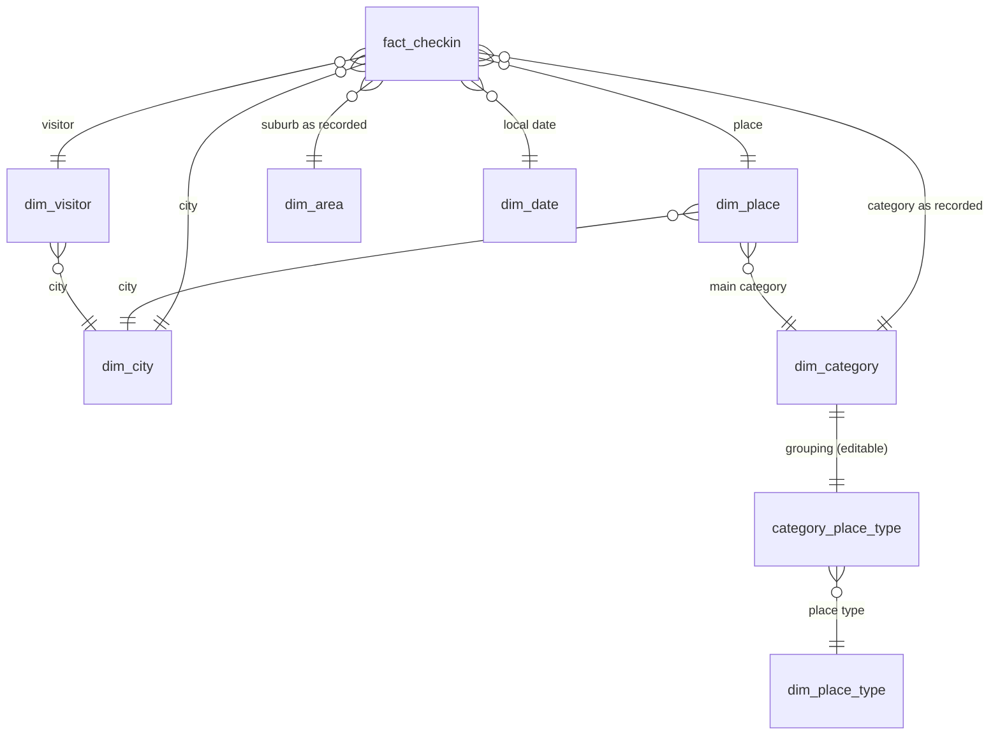

# BR6 Plan: Data Model (Star Schema)

This model is shared by every BR6 plan. [plan-data-import.md](plan-data-import.md) fills these tables; the Route Finder pipeline and the monitoring plans read them. Business rules come from [spec.md](../../spec/br6/spec.md). The structure follows BR5's model ([BR5 plan-data-model.md](../br5/plan-data-model.md)) so the two can be compared in the report.

## 1. Layers

```
data/br6/<city>_checkins.csv (15 files) ──Spark import job──► br6.raw_checkin             landing: the files as-is, one wide table
data/br6/cities.csv                                       └──► br6.dim_* + br6.fact_checkin  star schema: the main model for analysis
data/br6/category_place_type.csv                                         └──(pipeline plan)──► place statistics, run results
br6.pipeline_runs, br6.settings                                          run history and settings (never replaced by an import)
```

- **Database `br6`.** All BR6 tables live in their own ClickHouse database, like BR5. Fresh mode can then remove "BR6 data" in one clear place (spec D2).
- **Raw layer: `raw_checkin`.** An exact typed copy of the files, plus the city (file name) and lineage columns. It is kept for three reasons:
  - The spec asks for the data to be stored as-is.
  - The star schema can be rebuilt from it.
  - It is the "single wide table" baseline for the benchmarks.
- **The raw layer is not multiplied.** With the data multiplier (spec D12), only the fact table is repeated. Raw keeps exactly what the files hold, and repeating 2.6 million wide rows ×5 would cost disk and import time for no use. (BR5 repeated its raw table, but its file was 50× smaller.)
- **Star layer.** The model the app queries.
  - **No row is dropped and no value is changed.** Every source row becomes exactly one fact row (one per copy).
  - Check-ins without a location stay. Their place simply has no coordinates.
  - The cleaning rules of spec 3.5 (no location, far from the city, "Not offered") are applied at each run, which counts what each rule excluded.

## 2. What the data looks like (profiled on all 15 files)

These facts shaped the model:

| Fact | Consequence for the model |
|---|---|
| 2,629,541 rows in 15 files (from Beijing 1,470 to Istanbul 544,471). No line breaks inside values, but 3,852 lines use `""` inside quoted text and 127 contain `\` | The CSV is read with `"` as both quote and escape character. Spark's default escape is `\`, which would split some names wrongly |
| `trail_id`, `user_id` and `venue_id` repeat across cities (1,969 trail ids, 58k of the 74.5k venue ids) | Places, visitors and trails are identified **together with their city** (spec 3.3) |
| A venue always has the same name, address and coordinates | These go on the place dimension |
| Location (latitude, longitude, name) is missing for whole venues: 85,216 of 338,660 places, 348,592 check-ins | The place exists in the dimension with empty coordinates (`has_location = 0`) |
| **4,556 places (1.3%) have more than one category** over time (for example Grocery Store / Supermarket, Café / Coffee Shop); 486 of them tie for the most frequent | The fact keeps the category **as recorded** on each check-in. The place gets one **main category** (rule in 3.1) |
| 135 places have more than one `venue_city` (suburb) | The suburb is kept on the fact too, as recorded |
| 764 categories, each with one Foursquare id and one name. `venue_category_id_code` is a number per (city, category), not per category | The category dimension uses the Foursquare id. The code is kept in the raw table only |
| One country per city | The country goes on the city dimension |
| Timestamps are `YYYY-MM-DD HH:MM:00`, from 2012-04-03 to 2018-10-19. Busy hours fit UTC (for example Jakarta peaks at 11:00 = 18:00 local, New York at 23:00 = 19:00 local) | Stored as UTC. The date key is the **local** date of the city, using the city's time zone |
| The Tokyo file is mostly western Tokyo (median position in Hachiōji) | The "city centre" used by the far-from-city rule is the data's own centre (3.1), not the official one |

## 3. Star schema

**Grain of the fact table:** one check-in (one row of a file; with the multiplier, one row per copy).



### 3.1 Dimensions

| Table | Rows (all cities) | Columns | Source |
|---|---|---|---|
| `dim_city` | 15 | `city_key`, city_code (file name, for example `new_york`), city_name, country_code, country_name, timezone, centre_lat, centre_lon | `data/br6/cities.csv` (new: name, country name, time zone; covers spec D14). The centre is computed at import |
| `dim_place` | 338,660 | `place_key`, city_key, venue_id, name, address, latitude, longitude, has_location, main_category_key, categories_seen | venue columns. Name, address, latitude and longitude are empty when the source has none |
| `dim_visitor` | 80,299 | `visitor_key`, city_key, user_id | user_id |
| `dim_category` | 764 | `category_key`, category_id (Foursquare id), category_name | venue_category_id, venue_category |
| `dim_place_type` | 6 | `place_type_key`, place_type_name, is_offered, sort_order | `data/br6/category_place_type.csv` |
| `category_place_type` | 764 | category_key, place_type_key | Same file. An *outrigger* of `dim_category`: kept as its own small table because the team edits the grouping and **every run reloads it** (spec D13), while `dim_category` only changes with an import |
| `dim_area` | 482 | `area_key`, city_key, area_name, area_lat, area_lon | venue_city and its coordinates. Not used by the Route Finder; kept so the star holds every source value |
| `dim_date` | about 2,390 (every day from the first to the last local check-in date) | `date_key` (YYYYMMDD), date, year, quarter, month, month_name, iso_week, day_of_month, day_of_week, is_weekend | Generated, as in BR5 |

Rules:
- **Keys are small integers assigned deterministically.** Natural values are sorted and numbered from 1, so the same files always give the same keys, which keeps runs reproducible (spec section 4).
  - Places: by (city_key, venue_id). Visitors: by (city_key, user_id). Categories: by Foursquare id. Areas: by (city_key, area_name). Cities: by city_code.
  - Keys of places and visitors are numbered **per city and then offset** by the counts of the cities before it, not by one global sort. A window without `PARTITION BY` would move every row into one Spark task.
- **Main category of a place** = its most frequent category over its check-ins. A tie goes to the category of its latest check-in. `categories_seen` is how many categories the place had (1 for 98.7% of places). The Route Finder uses the main category, so a place has exactly one place type.
- **City centre** = median latitude and median longitude of the city's check-ins that have a location (exact median, so it is deterministic). On this data, 53 check-ins are more than 100 km from it.
- **Place types and grouping.** `dim_place_type` holds the five groups of spec 3.4 plus *Not offered* (`is_offered = 0`). A category that is missing from the file is put in *Not offered*, and the import reports how many there are (spec 3.4: "any category not yet grouped").
  - The first draft of the grouping is [`data/br6/category_place_type.csv`](../../../data/br6/category_place_type.csv) (section 5, for review).

### 3.2 Fact: `fact_checkin`

| Group | Columns |
|---|---|
| Dimension keys | city_key, place_key, visitor_key, category_key (as recorded), area_key (as recorded), date_key (local date) |
| Kept on the fact | checkin_time (`DateTime('UTC')`), trail_id (a degenerate dimension: 950k trails are too many for a table, and a trail has no attributes of its own) |
| Lineage | import_id, source_row (row number in its file), copy_no |

- There are no numeric measures: a check-in is an event. The measures (visits, different visitors, a visitor's share per place type) are **counts**, computed by the pipeline.
- **With the multiplier,** copy *n* keeps the same place but counts as a different visitor and trail: a visitor is (`visitor_key`, `copy_no`) and a trail is (`city_key`, `trail_id`, `copy_no`). So popularity grows ×N for every place alike, and dividing by N gives the original figure (spec 3.5). `dim_visitor` holds the original visitors only, which are the ones the Route Finder offers.

**Physical layout (starting point):**
- `MergeTree`, `PARTITION BY city_key` (15 partitions; every Route Finder query reads one city).
- `ORDER BY (city_key, place_key, visitor_key, checkin_time)`. This matches the two main reads: popularity per place, and one visitor's habits.
- Dimensions are `MergeTree ORDER BY <key>`. `dim_place` is `ORDER BY (city_key, place_key)`.
- Other layouts can be compared later (config spec C11, Could).

### 3.3 Raw: `raw_checkin`

| Columns | Type |
|---|---|
| city (file name) | `LowCardinality(String)` |
| trail_id | `String` |
| user_id, venue_id | `UInt32` (max 398,700 and 76,115) |
| latitude, longitude | `Nullable(Float64)` |
| name, address | `Nullable(String)` (address is empty on 597,610 rows) |
| venue_category, venue_category_id, venue_city, venue_country | `LowCardinality(String)` |
| venue_category_id_code | `UInt16` (max 618) |
| venue_city_latitude, venue_city_longitude | `Float64` |
| timestamp | `DateTime('UTC')` |
| import_id, source_row | `UUID`, `UInt32` |

`ORDER BY (city, source_row)`. The fact table uses the same types for the same values.

### 3.4 Run history and settings

- **`br6.pipeline_runs`** has the same columns as BR5's (after all BR5 plans): run id, type (`import` / `run`), status, step, times, step durations, row counts, multiplier, writer, source, import id, error, heartbeat, criteria, settings snapshot, rows used and excluded, result count and summary, Spark app id, resources.
  - It is created in one `CREATE TABLE`, without BR5's later `ALTER`s.
  - For an import, `criteria` holds the chosen cities.
- **`br6.settings`** has the same layout as `br5.settings`.
- Both are **never** dropped by fresh mode or replaced by an import (spec D2, M1–M5).

## 4. What the model gives the optimization story

The same Route Finder question can be answered on several models. The pipeline plan picks the main one; the others are for the benchmark:

| Variant | Where | What it shows |
|---|---|---|
| Wide table | `raw_checkin` | Baseline: no joins, but text keys (city + venue id) and wide rows |
| Star schema with joins | `fact_checkin` ⋈ dims | The standard warehouse model. The place dimension (339k rows) is large enough for the join strategy to matter |
| Star schema with dictionaries | `dictGet` on `dim_place`, `dim_category` | ClickHouse in-memory lookups instead of joins (ClickHouse engine, config spec C10) |
| Pre-aggregated | Place statistics (pipeline plan, "at import" option) | The cheapest run, at the cost of a build step |

Spark work that the import creates, which the import job logs and times:
- **CSV parsing** of 470 MB in 15 files of very different sizes (0.3 MB for Beijing to 98 MB for Istanbul). The number of read partitions follows `spark.sql.files.maxPartitionBytes`.
- **Data skew:** Istanbul and Petaling Jaya together hold 40% of the check-ins, and Beijing 0.06%. Work keyed by city is skewed, which is a real case for AQE skew handling.
- **Broadcast vs. shuffle join:** the fact is built by joining 2.6 million rows (×N) with `dim_place` (339k rows) and `dim_visitor` (80k rows). Whether `dim_place` is broadcast depends on `autoBroadcastJoinThreshold`, so it is a tuning case. BR5's dimensions were all tiny.
- **Window functions:** the per-city key numbering (3.1), the main category of each place, and the row number inside each file.
- **Caching:** the typed input feeds 7 outputs (the raw table, five dimensions and the fact), so caching it saves re-reading and re-parsing 470 MB.

## 5. Category → place type: first draft (spec open decision 2)

The whole table is [`data/br6/category_place_type.csv`](../../../data/br6/category_place_type.csv) (columns `category_id,category,place_type`, sorted by type). It was drafted by hand-picked lists plus two name rules (`… Restaurant`, `… Place`, `… Joint` → Food & drink; `… Bar`, `… Pub`, `… Stadium` → Entertainment & nightlife). Check-ins with a location, all 15 cities:

| Place type | Categories | Check-ins | Places | Biggest categories |
|---|---|---|---|---|
| Sights & culture | 35 | 84,091 (4%) | 8,354 | Plaza, Mosque, Church, Historic Site, Monument / Landmark, Art Gallery, museums, Temple |
| Nature & outdoors | 42 | 111,544 (5%) | 6,954 | Other Great Outdoors, Park, Waterfront, Pier, Harbor / Marina, Beach, Scenic Lookout, National Park |
| Food & drink | 213 | 674,064 (30%) | 81,590 | Café, Coffee Shop, Restaurant, Fast Food Restaurant, Malay Restaurant, Bakery, Burger Joint |
| Shopping | 61 | 336,630 (15%) | 23,123 | Shopping Mall (220k alone), Clothing Store, Bookstore, Department Store, Electronics Store |
| Entertainment & nightlife | 78 | 186,116 (8%) | 19,924 | Bar, Multiplex, Nightclub, Movie Theater, Pub, General Entertainment, Soccer Stadium, Karaoke Bar |
| Not offered | 335 | 888,504 (39%) | 118,008 | Neighborhood, Office, University, Road, Building, Metro/Train Station, Residential Building, Hotel |

Choices to review (beyond the spec's list of what is not offered):
- **Everyday errands are Not offered:** Grocery Store, Supermarket, Convenience Store, Drugstore, Pharmacy, Gas Station, Bank, car shops, laundry, salons, gyms and sports courts.
- **Transport is Not offered,** including Boat or Ferry (10k check-ins, mostly Istanbul ferries). Cruise is Entertainment & nightlife.
- **Places of worship are Sights & culture** (Mosque, Church, Temple, Shrine, Synagogue), as the spec's "temples" suggests. Many of them are neighbourhood mosques and churches, not landmarks.
- **Zoo and Theme Park are Entertainment & nightlife;** Aquarium and Planetarium are Sights & culture with the museums.
- **Other Great Outdoors** (50k check-ins, a generic Foursquare category) is Nature & outdoors.
- **Strip Club, Hotel Pool, Resort, Golf Course, Event Space and Convention Center are Not offered.**
